The **Financial Transaction Voucher** lets you handle many payments together instead of one at a time — receiving or paying several invoices, claims, returns or advances in a single document. Open the Financial Transaction Voucher list and click **Add Financial Transaction Voucher** to create one.

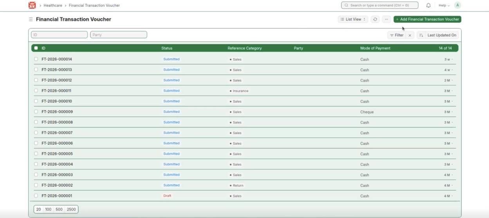

*Financial Transaction Voucher list — Add Financial Transaction Voucher*

In the new voucher, the **Transaction Type** lists the six kinds of bulk payment, explained below.

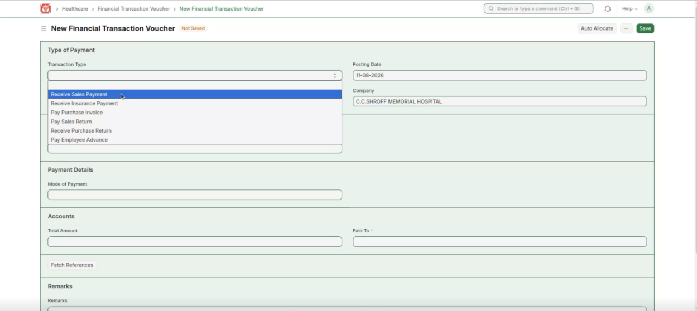

*Transaction Type — the six kinds of bulk payment*

## A. Receive Sales Payment

Used to collect many bills together — for example a corporate company tied up with the hospital that lets the bills add up and pays a lump sum at the end of the month.

**Steps:**

1. Create a new voucher and set Transaction Type to **Receive Sales Payment**. Fill the details — the party / corporate customer and the mode of payment.

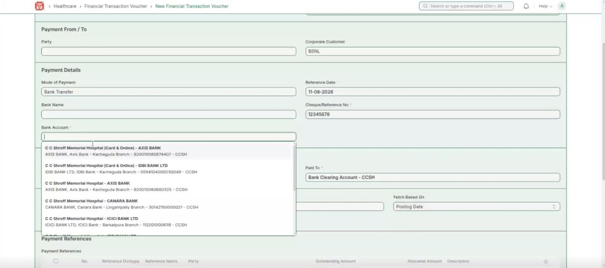

*Receive Sales Payment — fill the payment details*

2. Click **Save**, then **Submit**. The linked sales invoices are marked Paid, as the hospital now receives the money from the corporate.

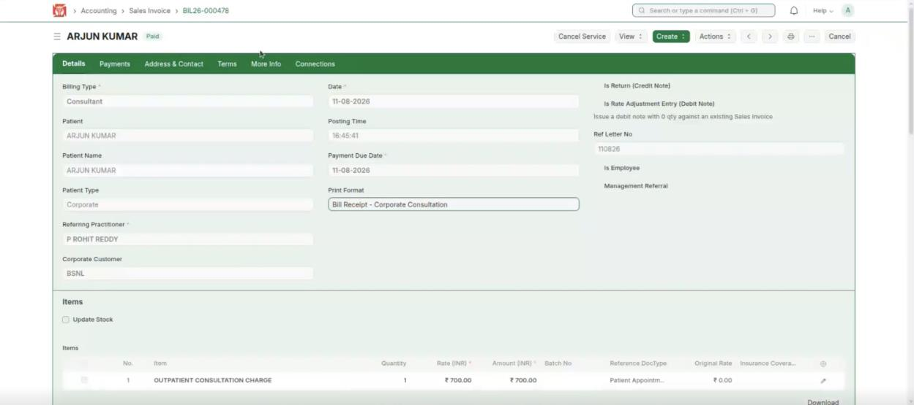

*Sales Invoice — marked Paid after submitting*

**Expected result:** The selected sales bills are settled together and shown as Paid.

## B. Receive Insurance Payment

Used when several patients have insurance from the same insurance company — you can claim and receive them all together.

**Steps:**

1. Set Transaction Type to **Receive Insurance Payment** and choose the Insurance Payor.

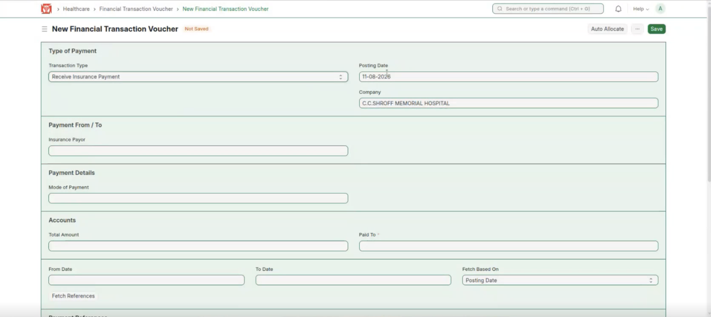

*Receive Insurance Payment — choose the insurance payor*

2. Fetch the claims — patients with the same insurer are claimed together — then **Save** and **Submit**. Each insurance claim changes from Submitted to Completed.

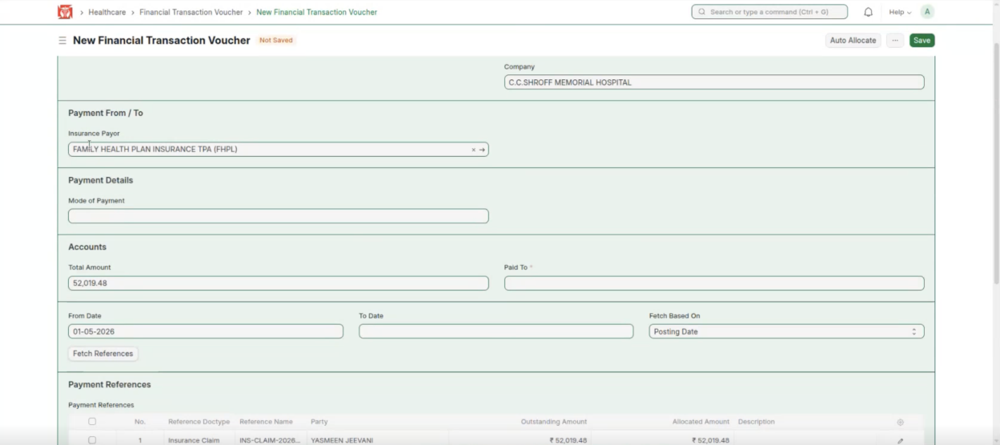

*Claims fetched for the payor — submit to complete them*

**Expected result:** All claims for that insurer are received together and marked Completed.

## C. Pay Purchase Invoice

The hospital buys medicines, equipment and other goods on many purchase invoices. Instead of paying each one, pay them together.

**Steps:**

1. Set Transaction Type to **Pay Purchase Invoice**. The purchase invoices are still unpaid (Overdue).

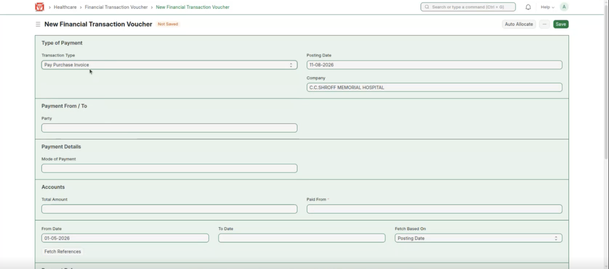

*Pay Purchase Invoice*

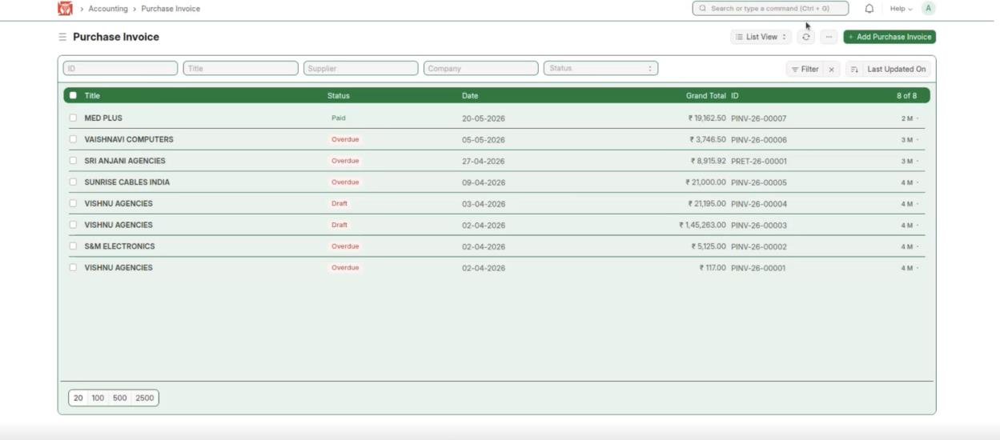

*Purchase Invoices — still unpaid*

2. Set the dates and click **Fetch References** to list the invoices due. Select the ones to pay, set the Mode of Payment, then **Save** and **Submit**.

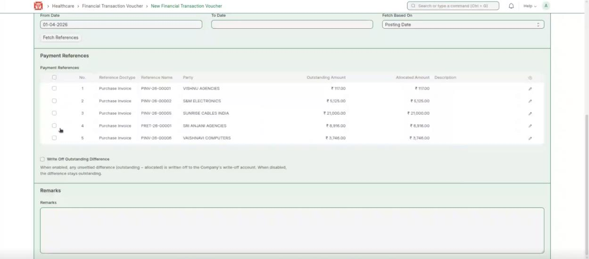

*Fetch References → select the invoices to pay*

3. The selected purchase invoices are now marked Paid.

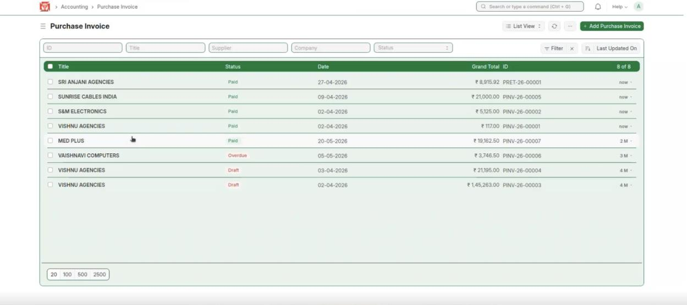

*Purchase Invoices — marked Paid*

**Expected result:** Several purchase invoices are paid together and shown as Paid.

## D. Pay Sales Return

Used to refund many patients who paid but did not use the service. When several patients cancel their service, you can refund them all together instead of one at a time.

**Steps:**

1. Set Transaction Type to **Pay Sales Return**.

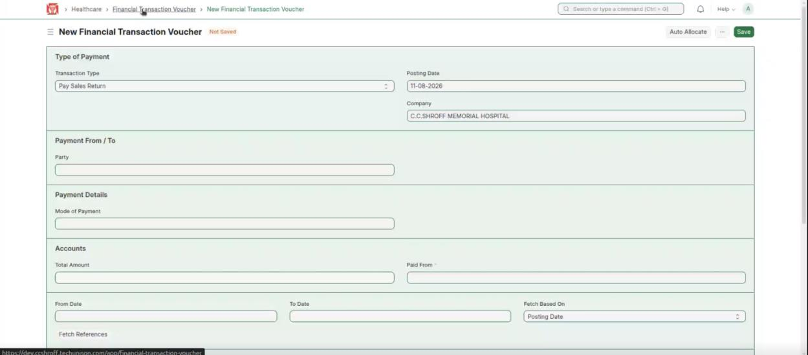

*Pay Sales Return*

2. Add the date the payment was made and click **Fetch References** — the refunds are fetched. Set the Mode of Payment and other details, then **Save** and **Submit**.

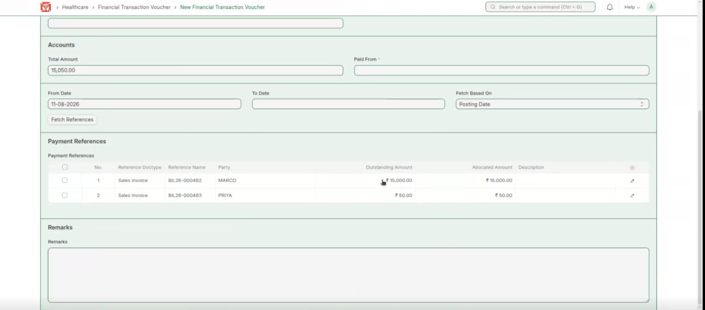

*Fetch References → the refunds to pay together*

**Expected result:** Several refunds are paid together in one voucher, without processing each one individually.

## E. Receive Purchase Return

The opposite of Pay Purchase Invoice. When the hospital returns unused goods or equipment to a vendor, use this to process the return invoices together and receive the money back.

**Steps:**

1. Set Transaction Type to **Receive Purchase Return**.

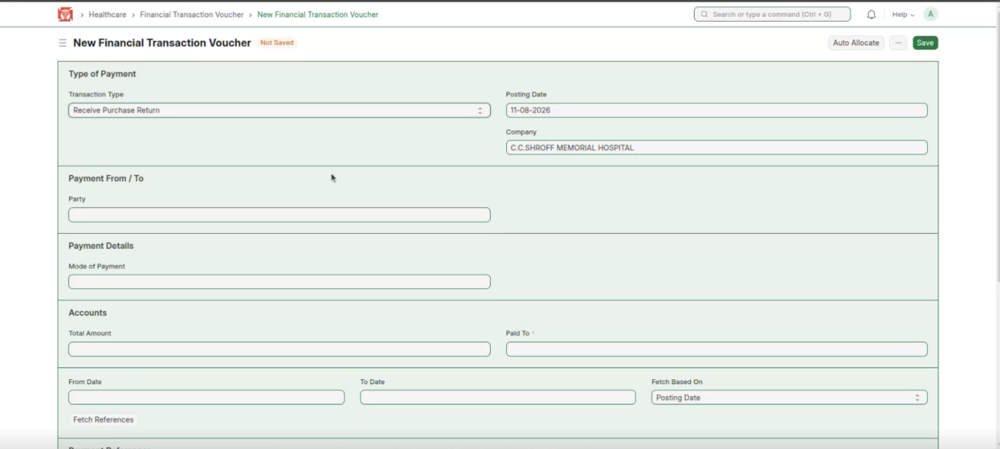

*Receive Purchase Return*

2. Enter the dates and click **Fetch References**, select the items to return, choose the Mode of Payment (how the money is received), then **Save** and **Submit**.

**Expected result:** Several purchase returns are processed together and the money is received.

## F. Pay Employee Advance

Used mainly in the HR module. Employees can take a salary or festival advance from the hospital, like a loan. When many employees take an advance (for example during festivals), they can be paid together.

**Steps:**

1. First, open a **New Employee Advance**, choose the employee, and write the reason (Purpose) and the amount.

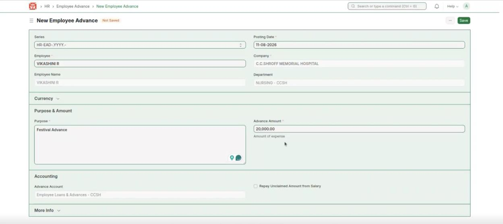

*New Employee Advance — employee, purpose and amount*

2. In a new voucher, set Transaction Type to **Pay Employee Advance**.

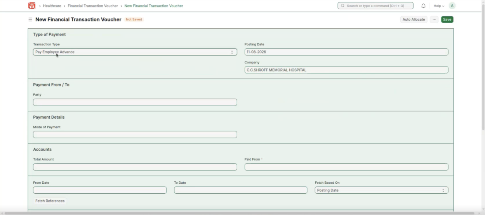

*Pay Employee Advance*

3. Enter the details, set the date, and select the employees whose advance is to be approved, then **Save** and **Submit** to approve the advance payment.

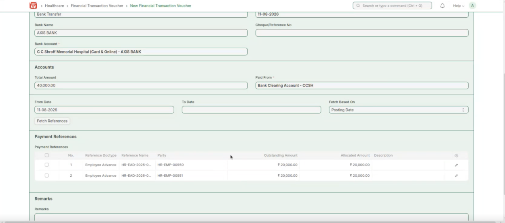

*Select the employee advances → Save and Submit*

**Expected result:** The selected employee advances are approved and paid together.
