This covers admitting and billing a patient whose bill is paid by a company (corporate) instead of the patient. It follows the patient from a new inpatient record through corporate billing, an advance payment, closing the bill and discharge. (Demo patient ARJUN KUMAR, billed to the company BSNL.)

**Flow:** New Inpatient Record → Admit → Payment By = Corporate → Corporate billing (Self / Dependent) → Corporate Revise Pricing → Advance payment → Schedule discharge → Close bill → Third Party Pending → Discharge

## Create and Admit the Patient

**Steps:**

1. Open a new Inpatient Record, enter the patient details, and click **Save**.

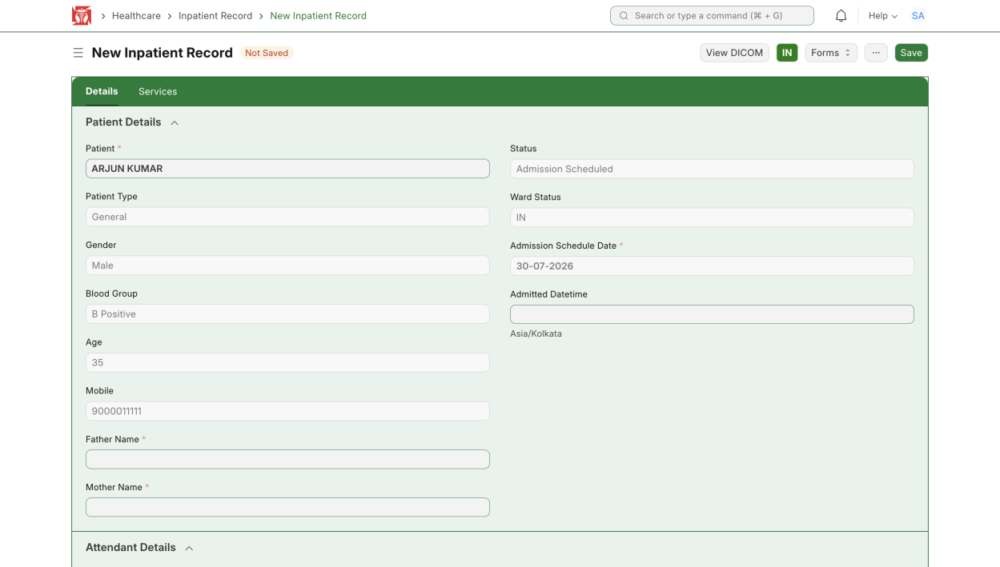

*New Inpatient Record — enter the patient details*

2. Click **Admit**. A Confirm message says the patient will be admitted under the Personal payment type with tariff TR1 – GENERAL. Click **Yes**.

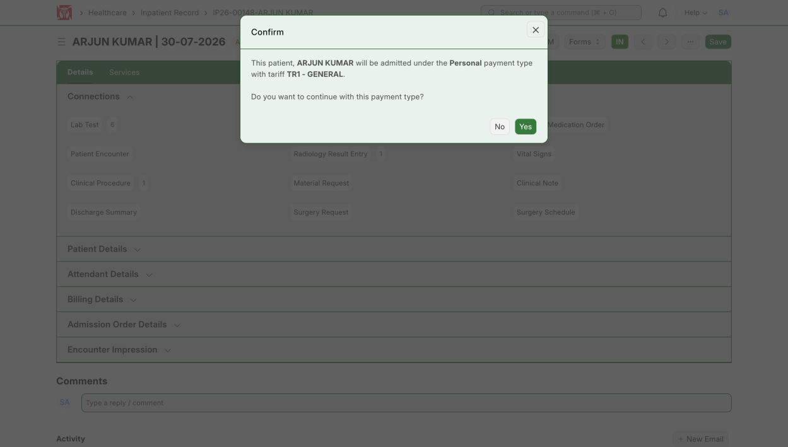

*Confirm — continue with the Personal payment type*

3. In the Admit Patient window, set the Ward, Bed and Admission Datetime, then click **Admit**.

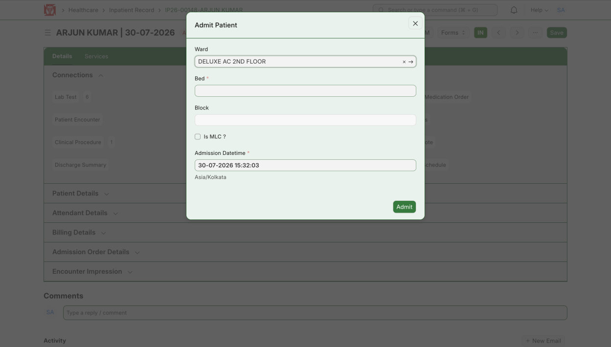

*Admit Patient — set the ward, bed and admission time*

**Expected result:** The patient is admitted and the inpatient record opens.

## Set the Payment Type to Corporate

**Steps:**

1. When the patient wants the bill paid by their company, open **Billing Details** and change **Payment By** to **Corporate**.

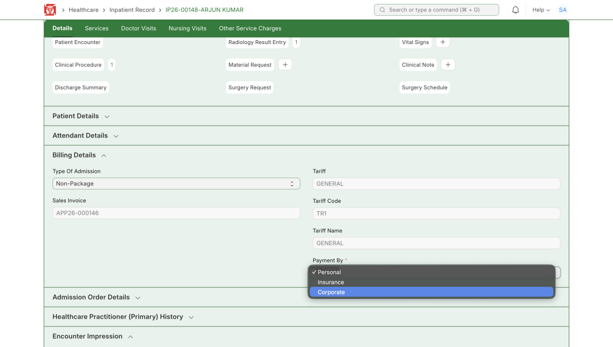

*Billing Details → Payment By → Corporate*

**Expected result:** The Corporate Billing Details form opens.

:::note
The patient starts as a General (Personal) patient. Changing Payment By to Corporate begins the conversion — after you save the corporate billing details, the Patient Type changes from General to Corporate.
:::

## Fill the Corporate Billing Details

**Steps:**

1. Enter the **Organization Name** (here BSNL) and choose the **Beneficiary Type** — Self or Dependent.
2. **Self** means the patient themselves holds the corporate card. Choose the Employee Option and enter the Employee ID.

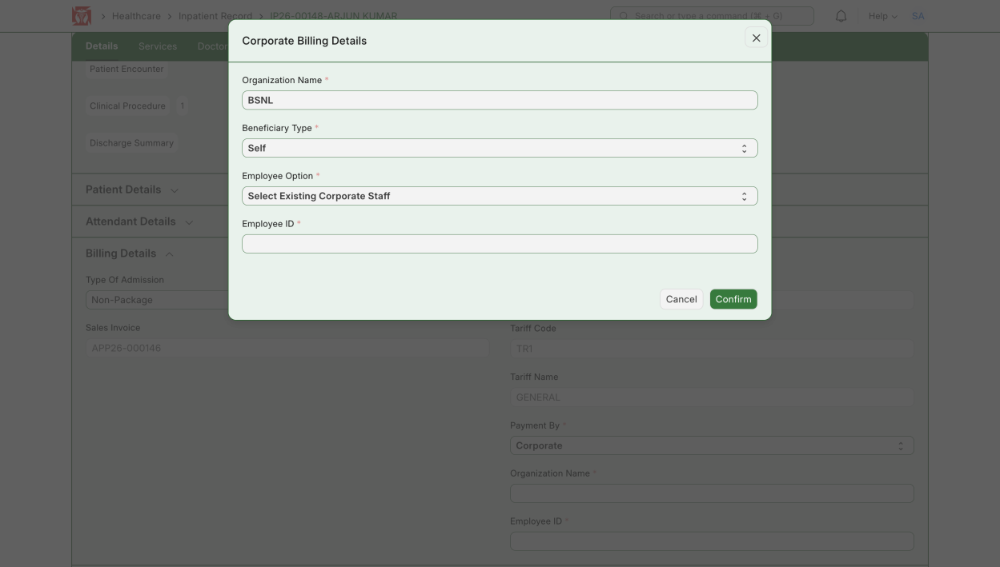

*Corporate Billing Details — Beneficiary Type = Self*

3. **Dependent** means a relative or family member of the patient holds the corporate card. Fill the card holder's staff details and the Relation to the patient.

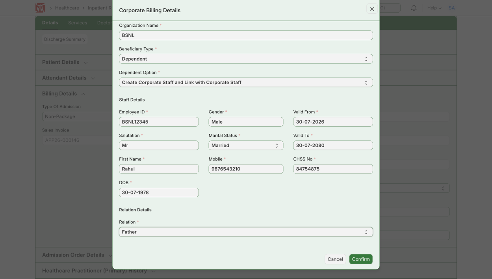

*Corporate Billing Details — Beneficiary Type = Dependent*

4. Click **Confirm** to save and update the patient details.

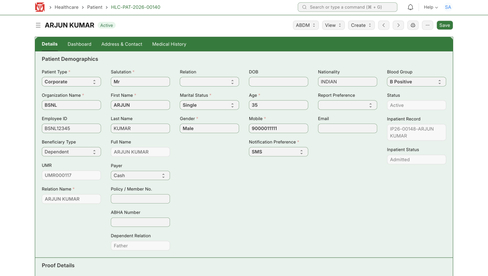

*The patient record is updated to Corporate*

**Expected result:** The patient's Patient Type is updated to **Corporate**.

:::note
Self = the patient holds the corporate card. Dependent = the card holder is the patient's relative or family member.
:::

## Revise to Corporate Pricing

**Steps:**

1. Back in Billing Details, click **Corporate Revise Pricing** to update the service prices in the sales invoice to the corporate rates.

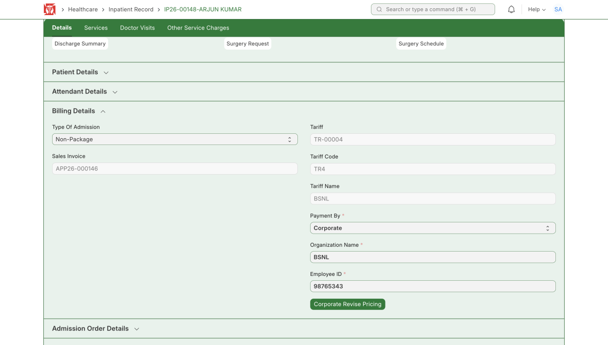

*Billing Details → Corporate Revise Pricing*

**Expected result:** The tariff changes to the corporate tariff (here TR-00004 / BSNL) and the invoice uses corporate prices.

## Advance Payment (if any)

**Steps:**

1. If the patient has paid an advance, click **Advance Payment**, choose the Mode of Payment, enter the Paid Amount, and **Save**.

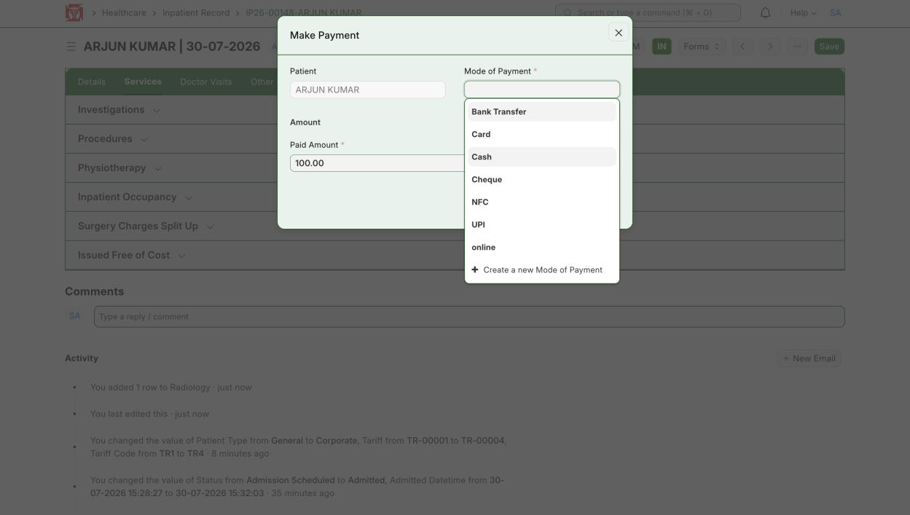

*Make Payment — record the advance payment*

**Expected result:** The advance payment is recorded against the patient.

:::note
An advance payment can be captured at any stage of the patient's stay; the advance is applied to the bill when you close it during discharge.
:::

## Schedule Discharge and Close the Bill

**Steps:**

1. Click **Schedule Discharge** and fill the discharge details (discharge practitioner, follow-up date and instructions).

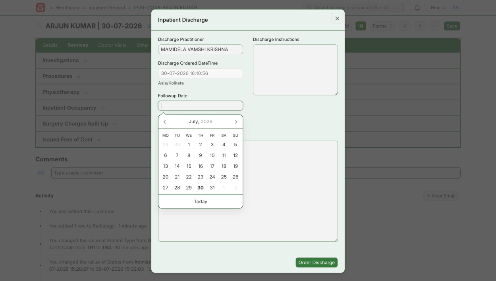

*Schedule Discharge — fill the discharge details*

2. Tick **Bill Closed**. A Confirm message warns that the patient cannot be re-admitted after the bill is closed — click **Yes**.

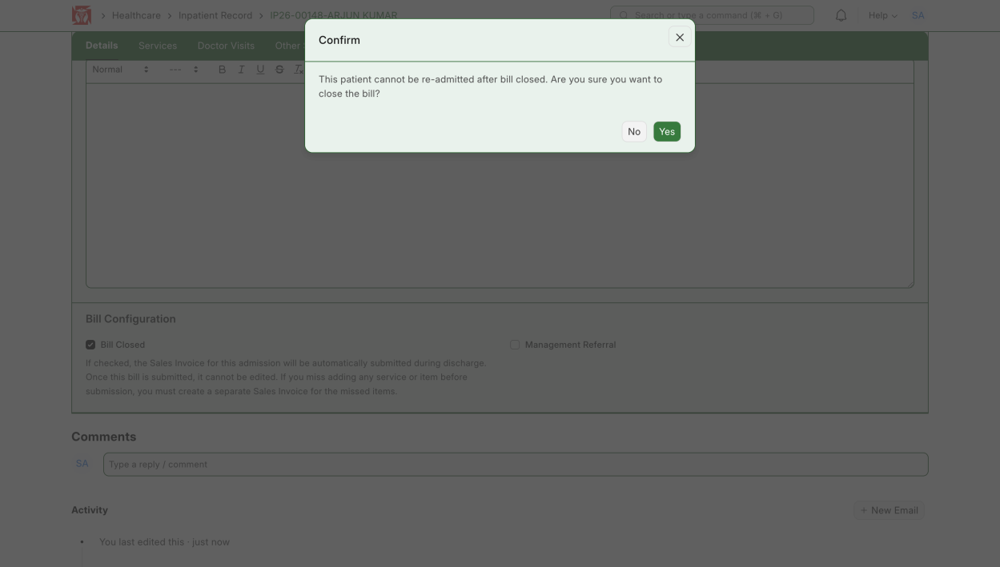

*Confirm — tick Bill Closed*

3. If the patient has an advance, the **Corporate Advance** box asks whether to adjust the advance or bill the full amount to the corporate. It shows the Service Cost and the Available Advance Amount. Enter the **Advance Amount To Include** — this is deducted from the patient's available advance balance — and click **Proceed Bill Close**. (If no advance was made, you can change or edit the details here.)

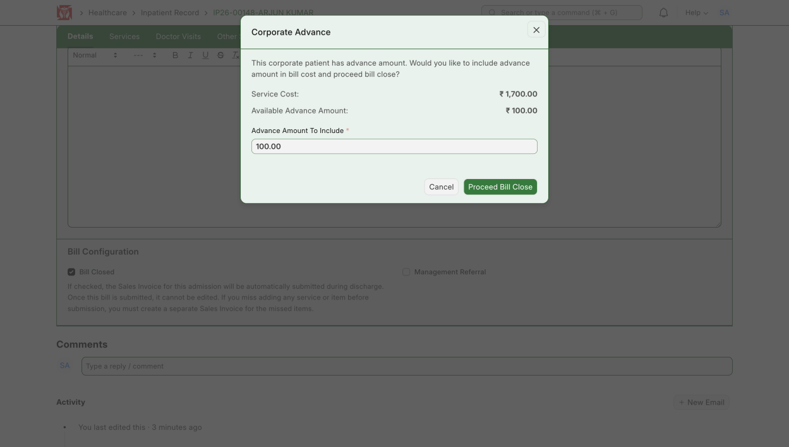

*Corporate Advance — include the advance and Proceed Bill Close*

**Expected result:** The bill is closed and the corporate sales invoice is created.

## Third Party Pending and Discharge

**Steps:**

1. Open the sales invoice — at the top it shows **Third Party Pending**. This means the hospital now gives the necessary documents to the corporate party and gets them to pay.

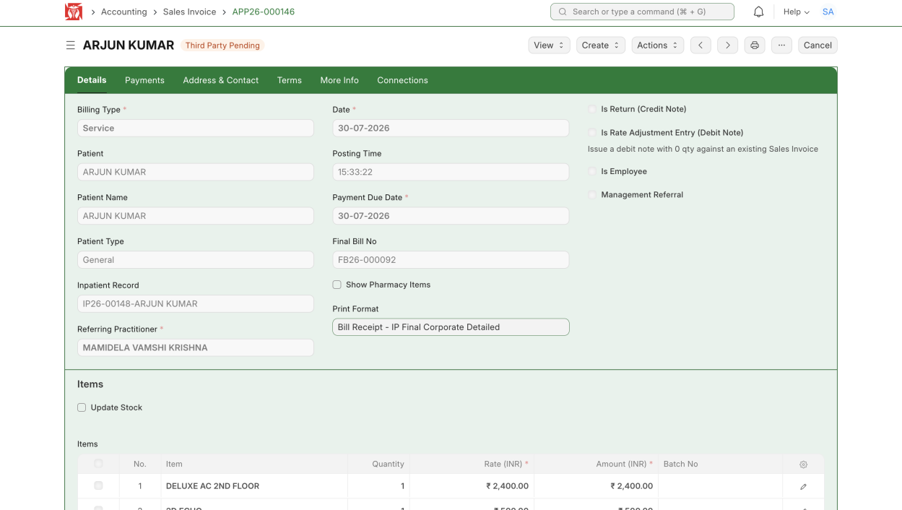

*Sales Invoice — Third Party Pending*

2. Discharge the patient. Confirm the discharge time and click **Confirm** — the payment is now left for the corporate party to settle.

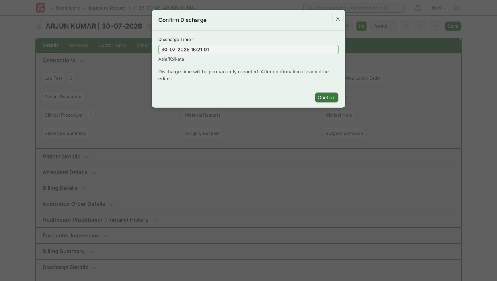

*Confirm Discharge — record the discharge time*

**Expected result:** The patient is discharged and the bill is left for the corporate party to pay.

:::note
"Third Party Pending" means the bill is billed to the company; the corporate party pays it, not the patient.
:::
