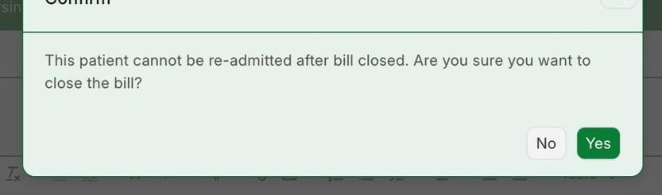
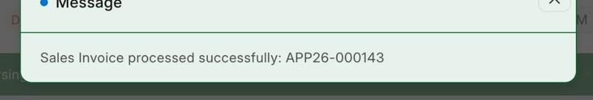
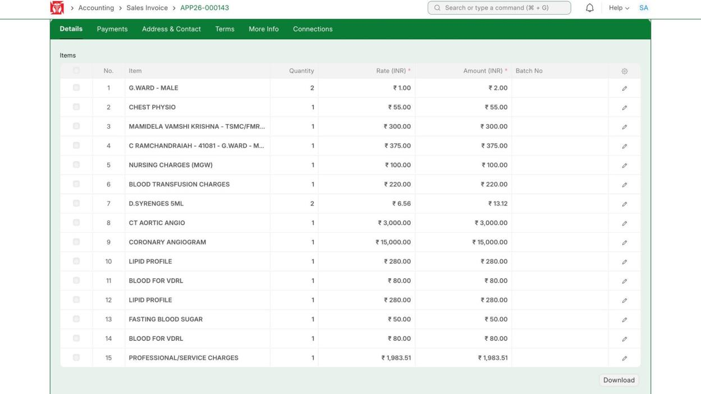
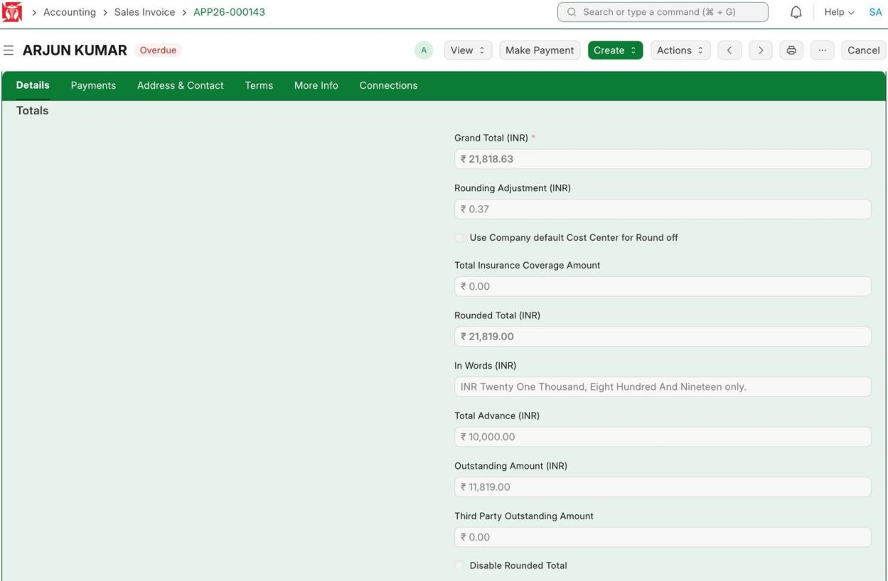
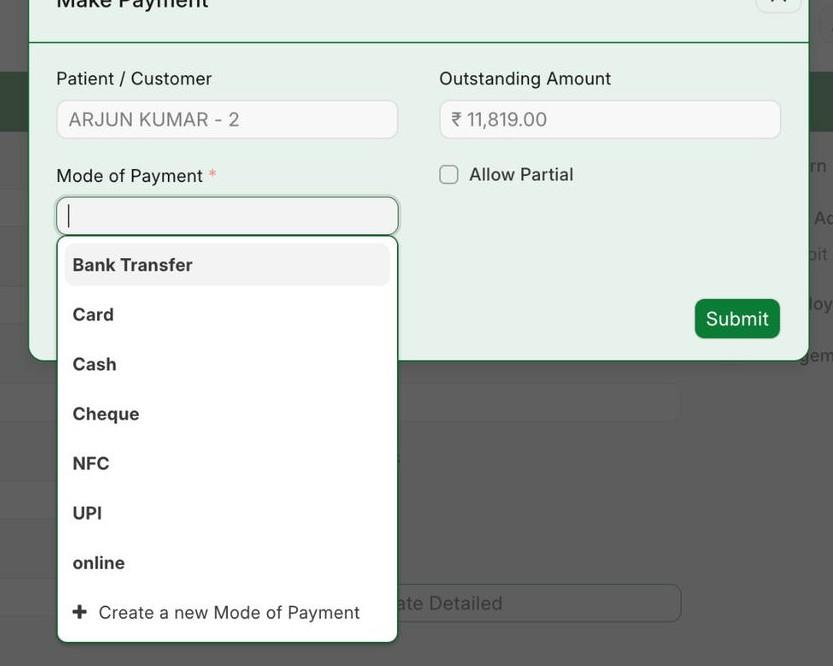
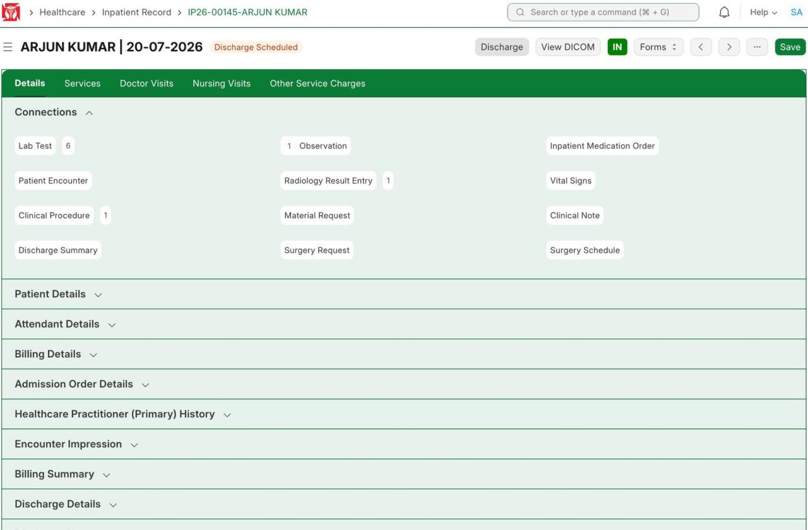
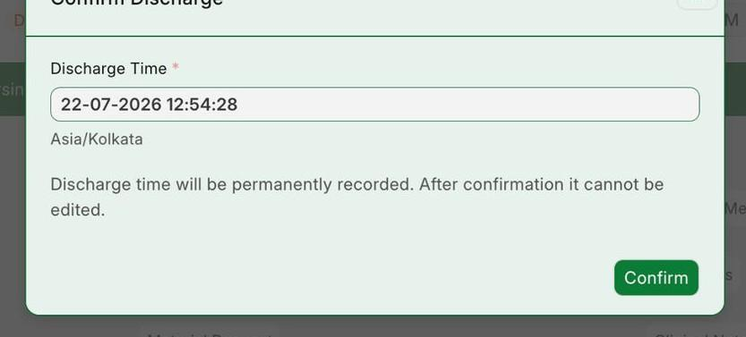
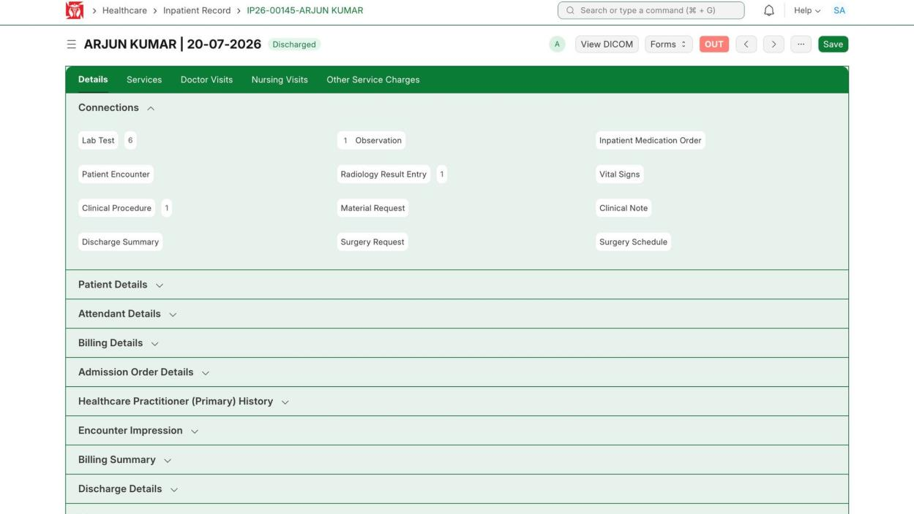
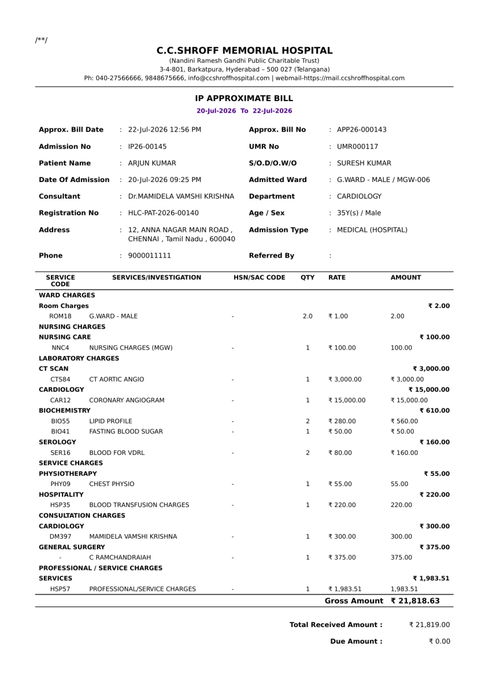
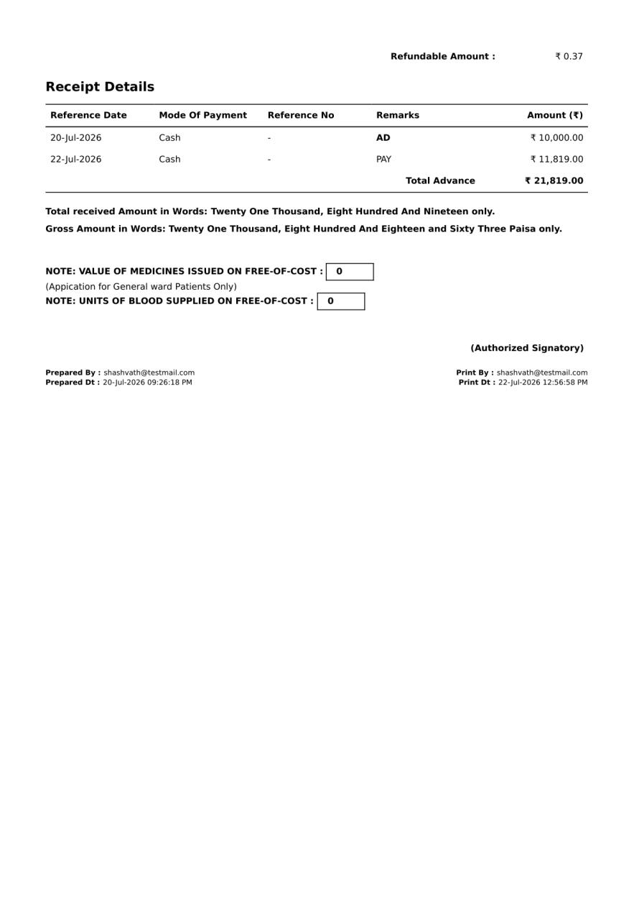

Before you can discharge, every finished service must be on the bill, the bill must be closed, and payment taken. Do the steps in this order to avoid the error where the bill will not submit while the patient is still admitted.

**Flow:** Bill the tests (finish lab collection) → Close bill (invoice is made) → Take payment → Discharge patient → Print the bill

:::warning
First make sure every finished service is billed. In particular, finish the Lab Test sample collection (see [Lab Test](../ward-workflows/lab-test.md)). A finished but unbilled test will stop the discharge.
:::

## 4.1 Close the Bill and Make the Invoice

**Navigate to:** Healthcare → Inpatient Record → IP26-00145 → Discharge Details

**Steps:**

1. In Discharge Details, tick **Bill Closed**. This will send the bill automatically at discharge. Once sent it cannot be changed, so add any missing item first.
2. A message asks "This patient cannot be re-admitted after bill closed. Are you sure?" — click **Yes**.

*Tick Bill Closed and confirm*

**Expected result:** The invoice is made and sent — you see "Sales Invoice processed successfully: APP26-000143" — and the record moves to **Discharge Scheduled**.

*Message — "Sales Invoice processed successfully: APP26-000143"*

## 4.2 Check the Bill (Sales Invoice)

**Navigate to:** Accounting → Sales Invoice → APP26-000143

**Steps:**

1. Open the invoice for this patient and check the items and totals.

*Bill items — ward, physiotherapy, doctor visits, nursing, tests, procedure*

*Totals — Grand Total ₹21,818.63, Advance ₹10,000, To pay ₹11,819*

**Expected result:** All charges are listed. After the ₹10,000 advance, the amount left to pay is ₹11,819.

## 4.3 Take the Payment

**Navigate to:** Sales Invoice APP26-000143 → Make Payment

**Steps:**

1. Click **Make Payment**. The amount to pay (₹11,819) is already filled.
2. Choose the payment mode (here Cash — Card, UPI, Cheque and others are also there), then **Submit**.

*Make Payment — choose the payment mode*

**Expected result:** A payment entry is made ("Payment Entry Created & Submitted: ACC-PAY-2026-00510") and the invoice shows **Paid**.

## 4.4 Discharge the Patient

**Navigate to:** Healthcare → Inpatient Record → IP26-00145 (Discharge Scheduled)

**Steps:**

1. Open the record — it shows Discharge Scheduled with a **Discharge** button.
2. Click **Discharge**. In the box, set the Discharge Time 2–3 hours ahead of now, so all paperwork can be finished. Once confirmed the time cannot be changed.
3. Click **Confirm**.

*Inpatient Record — Discharge Scheduled, with the Discharge button*

*Set the Discharge Time a little ahead, then Confirm*

**Expected result:** Status changes to **Discharged** and the toggle turns red (OUT).

*Inpatient Record — Discharged (red OUT)*

## 4.5 Print the Final Bill

**Navigate to:** Accounting → Sales Invoice → APP26-000143 (paid & discharged) → Print

**Steps:**

1. Open the paid patient's invoice and print it using the **Bill Receipt - IP Approximate Detailed** format.

**Expected result:** The full bill prints, showing all charges, the advance and final payment, Total ₹21,819.00, To pay ₹0.00.

*Final bill APP26-000143 — page 1*

*Final bill APP26-000143 — page 2 (receipts)*

## 4.6 After the Bill Is Closed

:::caution
Once Bill Closed is ticked and the invoice sent, it cannot be changed and the patient cannot be re-admitted. A missed or cancelled item then needs a separate invoice or credit note.
:::
