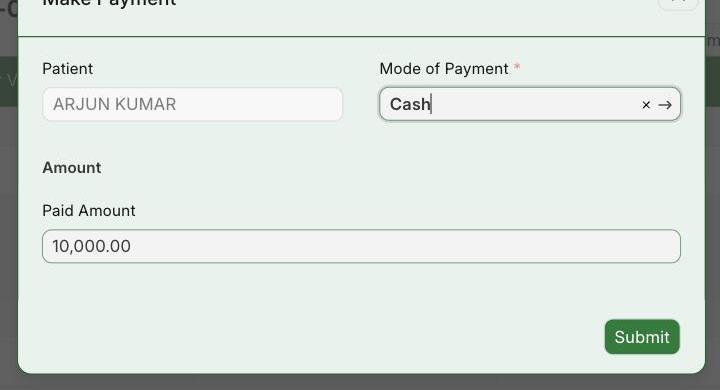
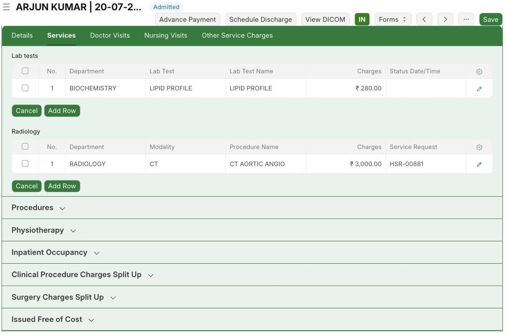
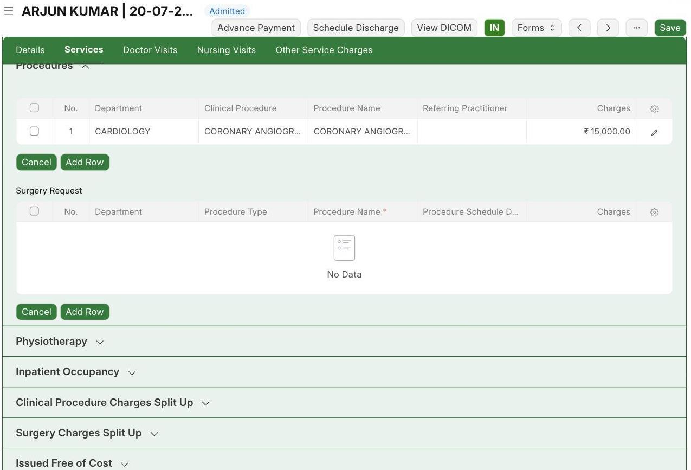
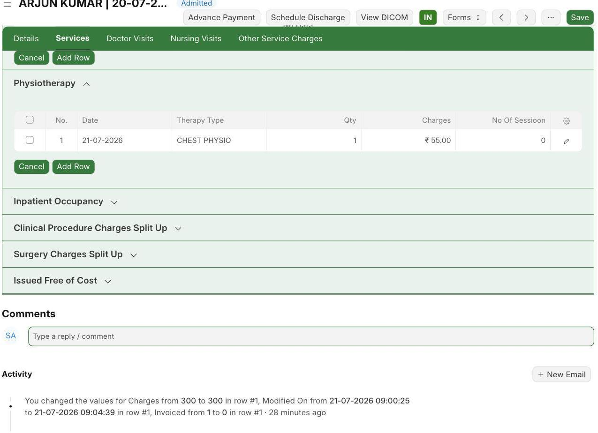
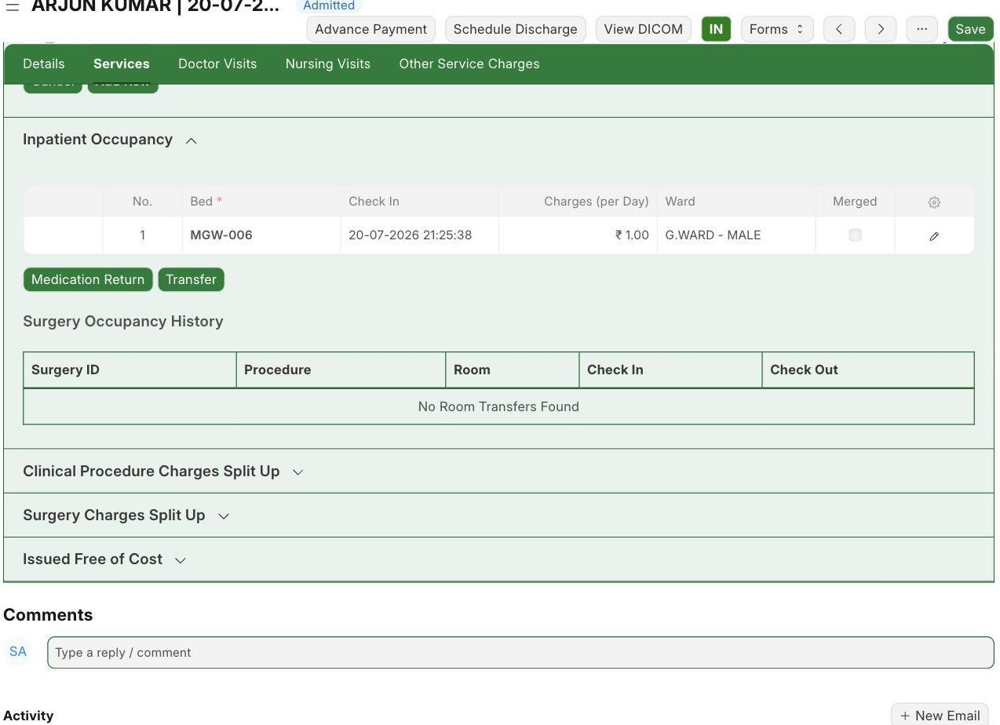
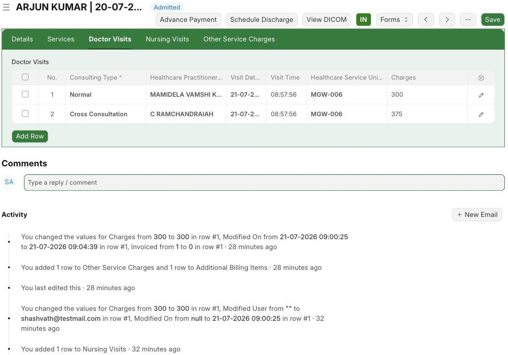
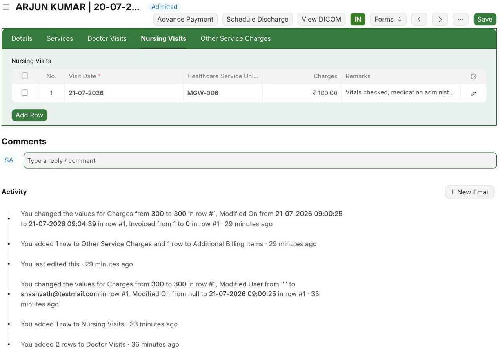
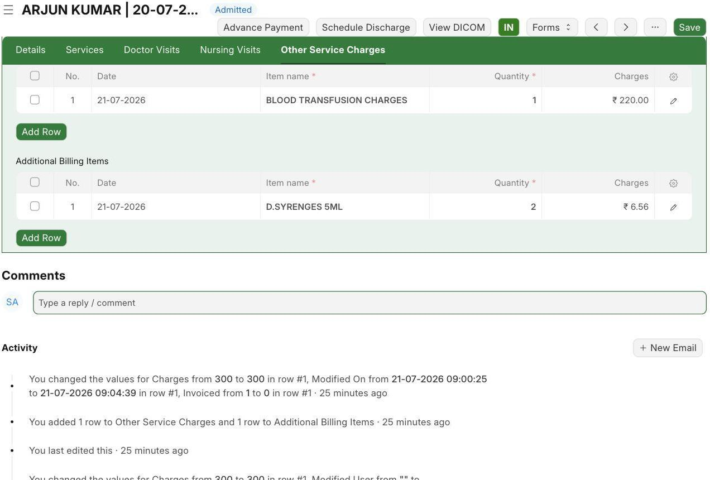

While the patient is admitted, you add charges as care is given. Each tab is for a different type of charge. Every save updates the running bill for the stay.

## 3.1 Take an Advance Payment

**Navigate to:** Inpatient Record → Advance Payment

**Steps:**

1. Click **Advance Payment** to collect money up front.
2. Type the amount (here ₹10,000) and the payment mode (Cash), then **Submit**.

*Advance Payment — ₹10,000 by Cash*

**Expected result:** The advance is saved, and a receipt is given. It lowers what the patient pays at discharge.

## 3.2 Services Tab

The Services tab is where you add clinical charges. It has parts for Investigations (lab and scans), Procedures, Physiotherapy, and Inpatient Occupancy (bed charge). In each part click **Add Row**, pick the item, and the price fills in on its own.

- **Investigations:** LIPID PROFILE (₹280) and CT AORTIC ANGIO (₹3,000).

*Investigations — LIPID PROFILE and CT AORTIC ANGIO*

- **Procedures:** CORONARY ANGIOGRAM under CARDIOLOGY (₹15,000).

*Procedures — CORONARY ANGIOGRAM*

- **Physiotherapy:** CHEST PHYSIO (₹55). This is where physiotherapy / therapy sessions are added.

*Physiotherapy — CHEST PHYSIO*

- **Inpatient Occupancy:** the bed MGW-006 in G.WARD - MALE, charged per day.

*Inpatient Occupancy — bed charge per day*

:::note
The Clinical Procedure and Surgery split-up tables fill in by themselves when a procedure is done — you do not type them.
:::

## 3.3 Doctor Visits Tab

**Navigate to:** Inpatient Record → Doctor Visits

**Steps:**

1. Click **Add Row** and pick the Consulting Type — **Normal** for the main doctor's round, or **Cross Consultation** when another department is called.
2. Pick the doctor and ward; the visit charge fills in on its own.
3. Here: a Normal visit by MAMIDELA VAMSHI KRISHNA (₹300) and a Cross Consultation by C RAMCHANDRAIAH (₹375).

*Doctor Visits — Normal and Cross Consultation entries*

**Expected result:** Each doctor visit is saved with its charge.

## 3.4 Nursing Visits Tab

**Navigate to:** Inpatient Record → Nursing Visits

**Steps:**

1. Click **Add Row**, set the visit date and the ward, and add any remark; the nursing charge fills in on its own.
2. Here: a visit on 21-07-2026 from MGW-006 at ₹100 with the note "Vitals checked, medication administered".

*Nursing Visits — logged visit (₹100)*

**Expected result:** Nursing care is saved with the charge and note.

## 3.5 Other Service Charges Tab

**Navigate to:** Inpatient Record → Other Service Charges

**Steps:**

1. There are two tables: **Other Service Charges** (hospital services) and **Additional Billing Items** (things used, like syringes).
2. Click **Add Row**, pick the item and quantity, and the charge fills in.
3. Here: BLOOD TRANSFUSION CHARGES (Qty 1, ₹220) and D.SYRENGES 5ML (Qty 2, ₹6.56).

*Other Service Charges and Additional Billing Items*

**Expected result:** Extra services and items are added to the bill.
