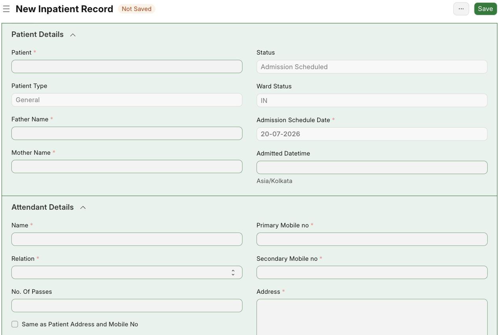
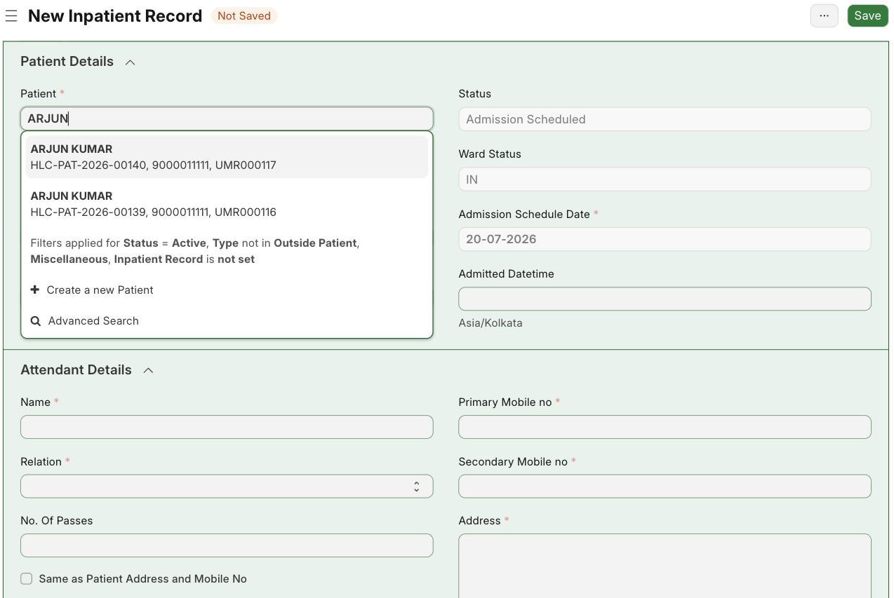
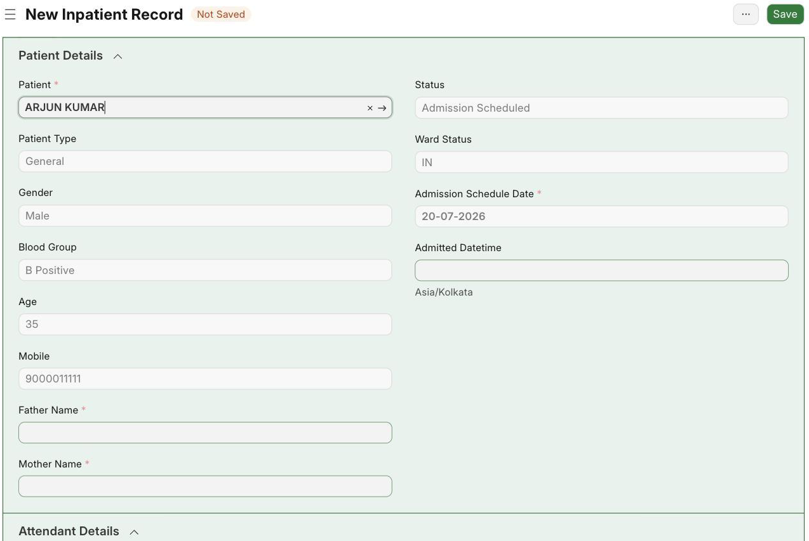
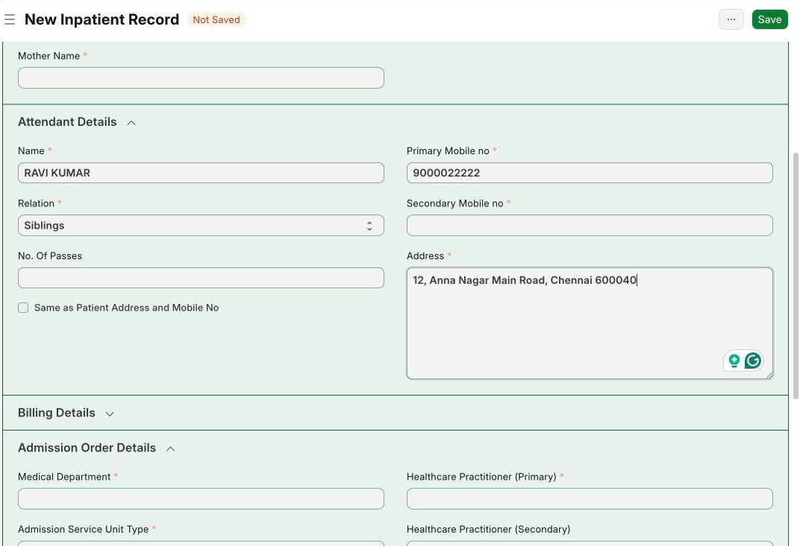
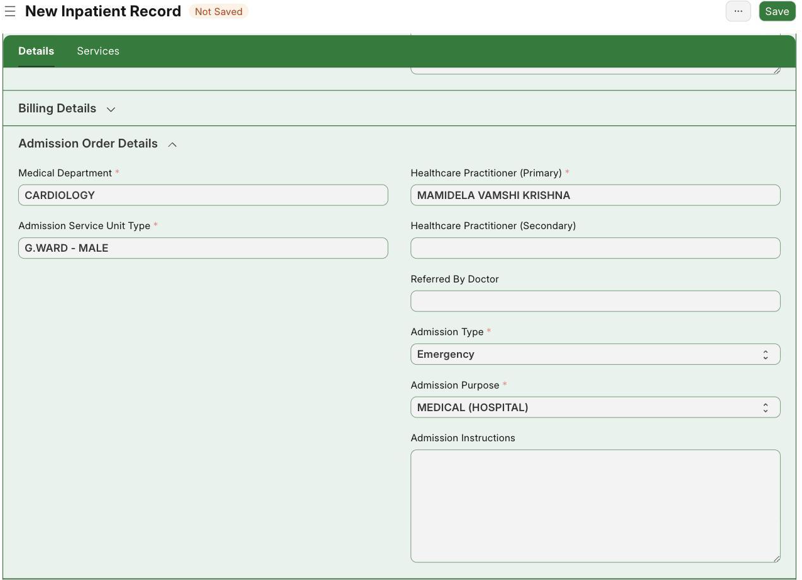
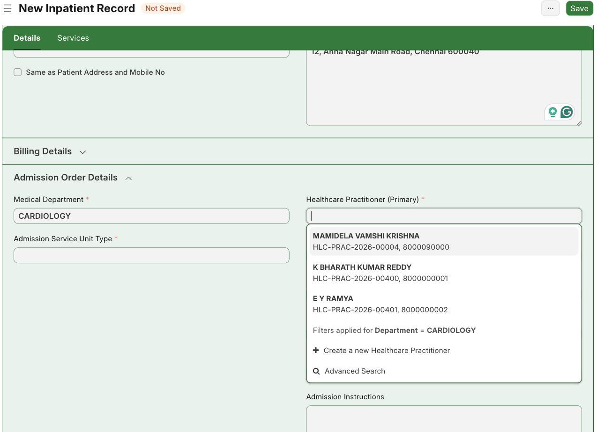
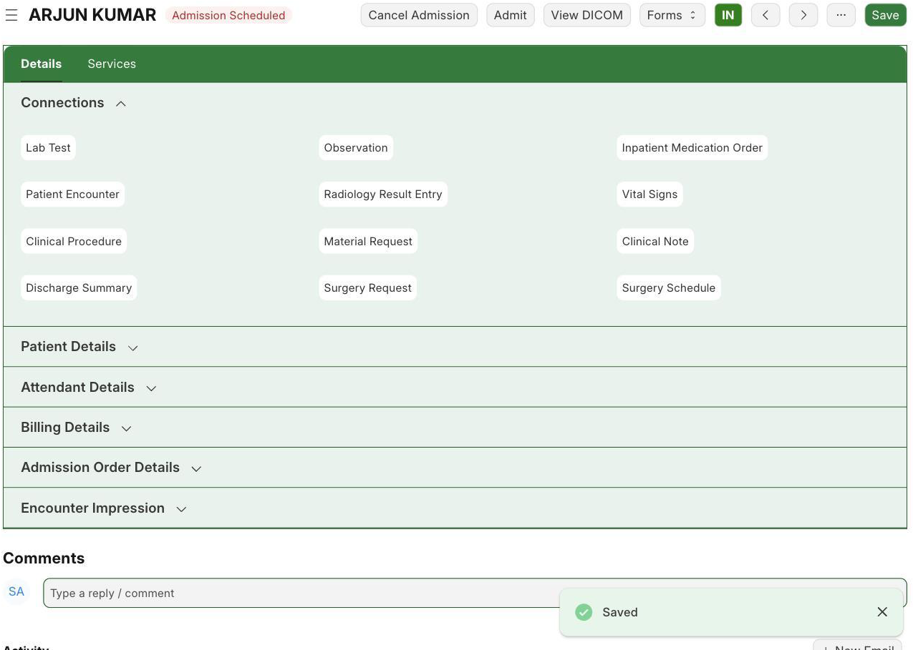
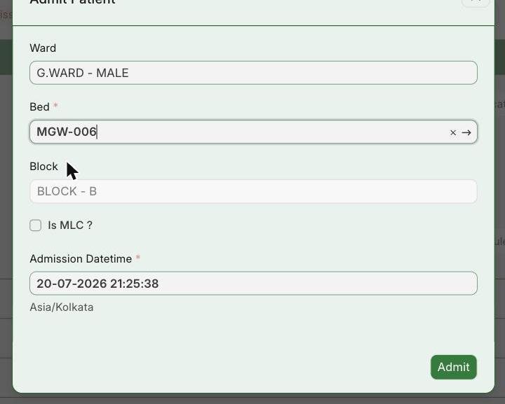

The Inpatient Record holds the patient, attendant, billing and admission details. It starts as **Admission Scheduled** and becomes **Admitted** once a bed is given.

## 2.1 Create a New Inpatient Record

**Navigate to:** Healthcare → Inpatient Record → + Add Inpatient Record

**Steps:**

1. Open a blank Inpatient Record. It opens with Status = Admission Scheduled and today's date filled in.
2. The form has four parts: Patient Details, Attendant Details, Billing Details and Admission Order Details.

*Blank Inpatient Record form*

**Expected result:** A blank Inpatient Record is ready to fill.

## 2.2 Choose the Patient

**Navigate to:** Inpatient Record → Patient field

**Steps:**

1. In the Patient box, start typing the name (ARJUN).
2. Pick the correct patient from the list — it shows the Patient ID, mobile and UMR.

*Choosing the patient — matches show Patient ID, mobile and UMR*

**Expected result:** The right patient is selected.

## 2.3 Patient Details Fill In Automatically

**Steps:**

1. When you pick the patient, the Patient Details fill in on their own.

*Patient details filled automatically after choosing the patient*

**Expected result:** You see Gender Male, Blood Group B Positive, Age 35 and Mobile 9000011111 — this confirms the right patient.

## 2.4 Add Attendant Details

**Steps:**

1. Write who came with the patient: RAVI KUMAR, Relation Siblings, mobile 9000022222, and address.
2. Tick **Same as Patient Address and Mobile No** if the contact is the same as the patient's.

*Attendant details filled in*

**Expected result:** The person with the patient is saved.

## 2.5 Set Billing and Admission Order

**Steps:**

1. **Billing Details:** Type Of Admission = Non-Package, Payment By = Personal.
2. **Admission Order Details:** Department = CARDIOLOGY, Ward type = G.WARD - MALE, Admission Type = Emergency, Purpose = MEDICAL (HOSPITAL).
3. The Doctor (Healthcare Practitioner) list only shows doctors from the chosen department.

*Billing and Admission Order details*

*The doctor list is filtered to CARDIOLOGY doctors*

**Expected result:** Billing and admission order are set, and only CARDIOLOGY doctors are shown.

## 2.6 Save the Record

**Steps:**

1. Click **Save**.

*Saved record — number IP26-00145, Status Admission Scheduled*

**Expected result:** The record gets a number (IP26-00145) and Status = Admission Scheduled. Buttons appear: **Admit**, **Cancel Admission** and **Forms**.

## 2.7 Patient Admission and Bed Allotment

**Steps:**

1. Click **Admit**. Confirm the payment type, then the Admit Patient box opens.
2. Choose the Ward (G.WARD - MALE), the Bed (MGW-006) and the Admission date and time, then click **Admit**.

*Admit Patient box — choosing the bed (MGW-006)*

**Expected result:** Status changes to **Admitted**. New tabs appear (Services, Doctor Visits, Nursing Visits, Other Service Charges) along with **Advance Payment** and **Schedule Discharge**.
