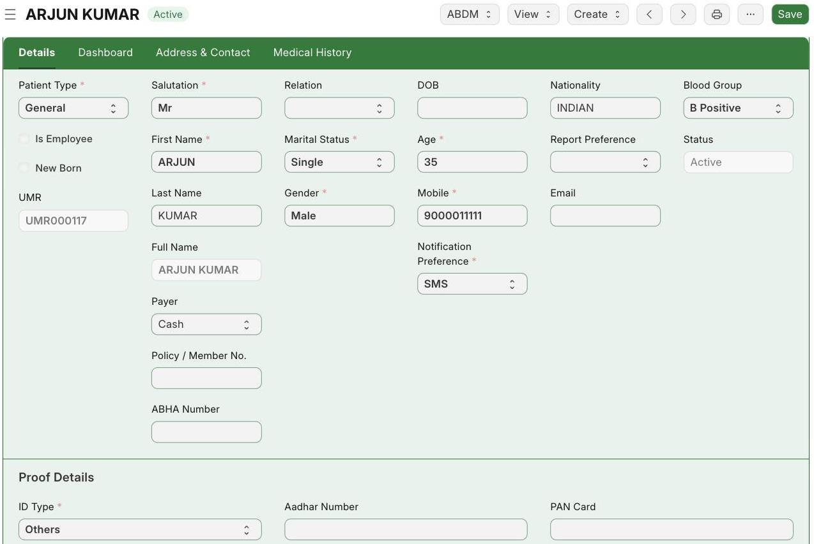

**Flow:** Open New Patient → Fill name, age, gender, mobile, blood group → Save → Patient ID and UMR are created → Status: Active

## 1.1 Register a New Patient

**Navigate to:** Healthcare → Patient → New Patient

**Steps:**

1. Open the New Patient form. Patient Type is already set to **General** and Nationality to **INDIAN**.
2. Fill the starred fields: Salutation, Marital Status, Age, First Name, Gender and Mobile. Add Blood Group and address too.
3. For this patient: Mr. ARJUN KUMAR, Single, Age 35, Male, Mobile 9000011111, Blood Group B Positive.
4. Click **Save**.

*After saving — the patient now has a Patient ID and UMR, and the Status is Active*

**Expected result:** The system gives the patient a Patient ID (HLC-PAT-2026-00140) and a UMR number (UMR000117). Use these to find the patient on later visits.

## 1.2 Revisit

**Navigate to:** Healthcare → Patient (list)

**Steps:**

1. If the patient has been here before, do not register again.
2. Search the Patient list by mobile number or name and open the correct record. Check the UMR to be sure it is the right person.

**Expected result:** The existing patient is found and can be used for a new admission — no need to register again.
