This covers admitting and billing a patient whose bill is (partly) paid by an insurance company through a TPA. It follows the patient from admission under Insurance, collecting the insurance policy, generating and approving insurance coverage, and discharging with the patient paying any balance. (Demo patients DAVID BECHKHAM and MARCO.)

**Flow:** Payment By = Insurance → Admit → Lab / Radiology / Procedures (as General) → Collect Insurance Policy → Generate Insurance Coverage & Revise Pricing → Attach approval letter → Approve coverage → Discharge → Raise insurance claim → Receive insurer payment

## Admit under Insurance

**Steps:**

1. In the inpatient record's Billing Details, set **Payment By** to **Insurance**, then click **Save**.

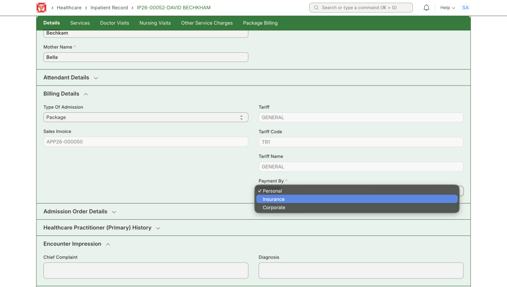

*Billing Details → Payment By → Insurance*

2. Click **Admit**. A Confirm message shows the patient will be admitted under the Insurance payment type (tariff TR1 – GENERAL) through the insurance TPA. Click **Yes**.

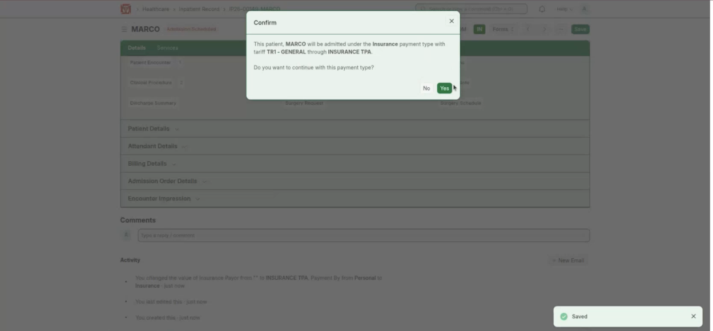

*Confirm — admit under the Insurance payment type*

:::note
Lab tests, radiology and clinical procedures are done exactly as in the General workflow.
:::

## Collect the Insurance Policy

**Steps:**

1. After the services are done and the bill is being generated, open Billing Details and tick **Collect Insurance Policy**. In Insurance Policy, pick the patient's existing policy, or choose **Create a new Patient Insurance Policy**.

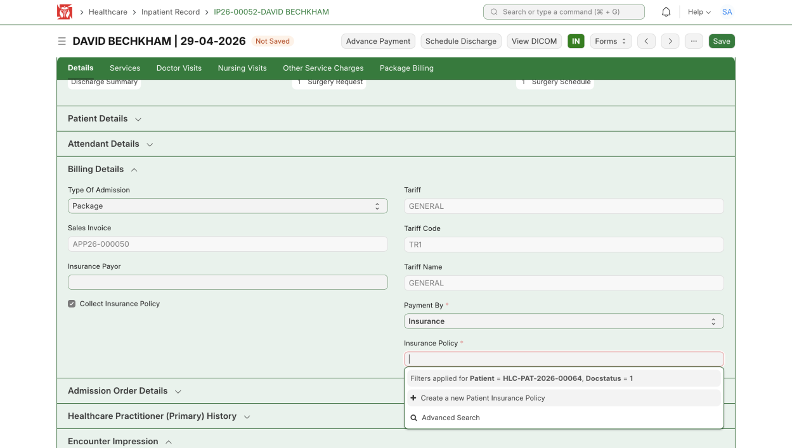

*Billing Details → Collect Insurance Policy → select or create a policy*

2. For a new policy, fill the details — insurance payor, policy number, expiry date, insured person and policy holder relationship — then **Save**.

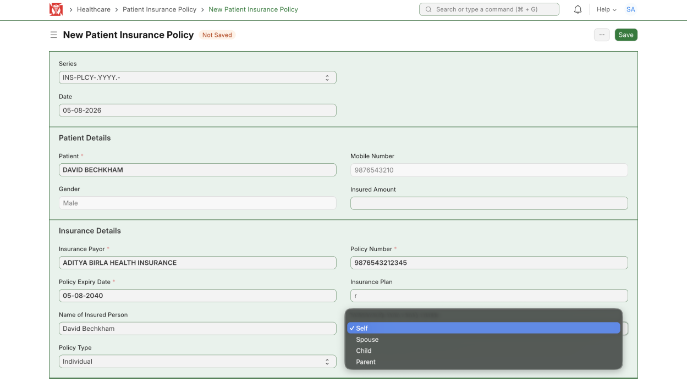

*New Patient Insurance Policy — fill the details*

3. Click **Submit** and confirm to submit the policy.

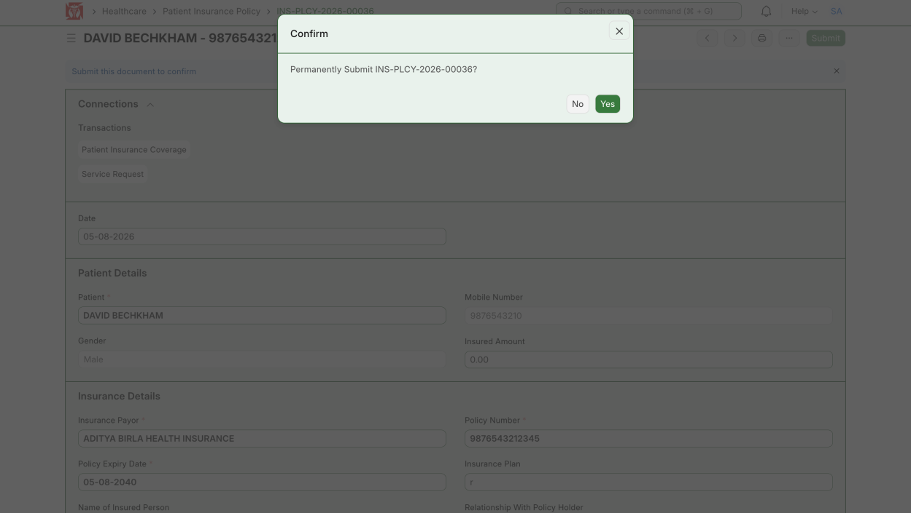

*Confirm — submit the insurance policy*

**Expected result:** The insurance policy is submitted and linked to the patient.

## Generate Insurance Coverage

**Steps:**

1. Back in Billing Details, click **Generate Insurance Coverage & Revise Pricing**.

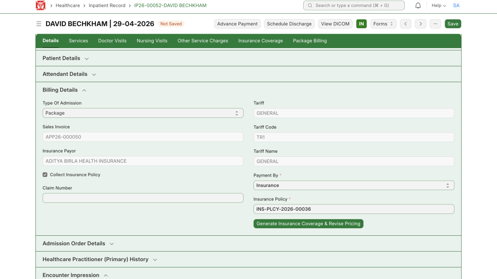

*Billing Details → Generate Insurance Coverage & Revise Pricing*

2. Insurance coverages are created for all the services.

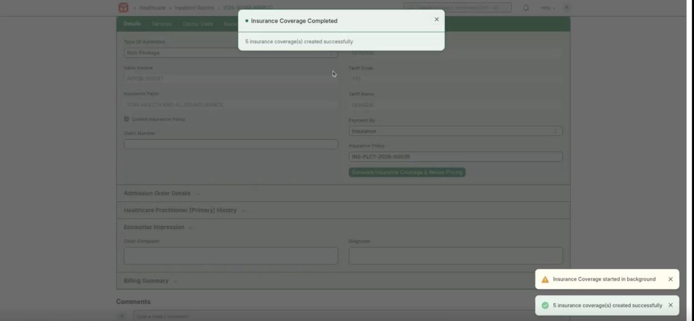

*Insurance coverage created successfully*

3. Open the **Insurance Coverage** tab to see each coverage with its original and revised rates, bill amount, and the insurance claim and patient-payable totals.

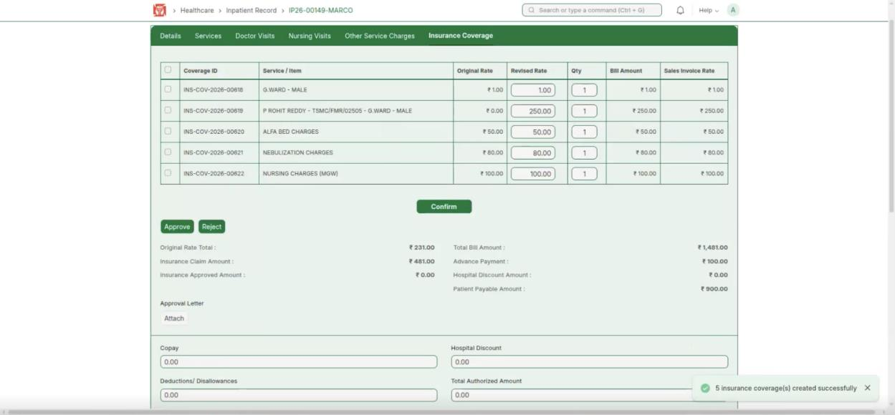

*Insurance Coverage tab — coverages and totals*

**Expected result:** Insurance coverage is created for every service and the pricing is revised.

## Approve the Coverage

**Steps:**

1. Next to **Approval Letter**, click **Attach** and upload the insurer's approval letter (from your device, library, link or camera).

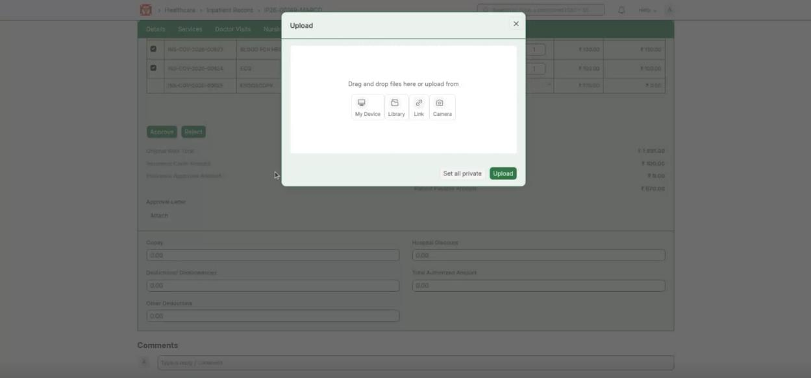

*Attach the insurer's approval letter*

2. Click **Approve** to approve the insurance coverage.

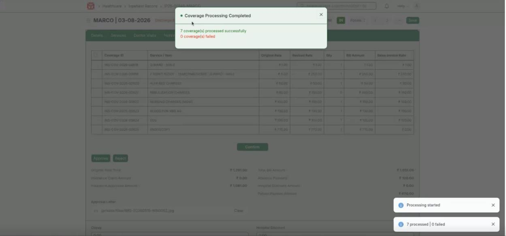

*Coverage processed and approved*

**Expected result:** The insurance coverage is approved and processed.

## Discharge and Collect the Balance

**Steps:**

1. Discharge the patient and collect any remaining amount that insurance did not cover or approve (the **Patient Payable Amount**).

:::note
Insurance may not cover everything — the patient pays the balance, such as co-pay, deductions or unapproved items.
:::

After discharge, the hospital claims the covered amount back from the insurer and records the payment received.

## Raise the Insurance Claim

**Steps:**

1. Open the **Insurance Claim** list and pick the patient. If they are not listed, click **Add Insurance Claim** (top right).

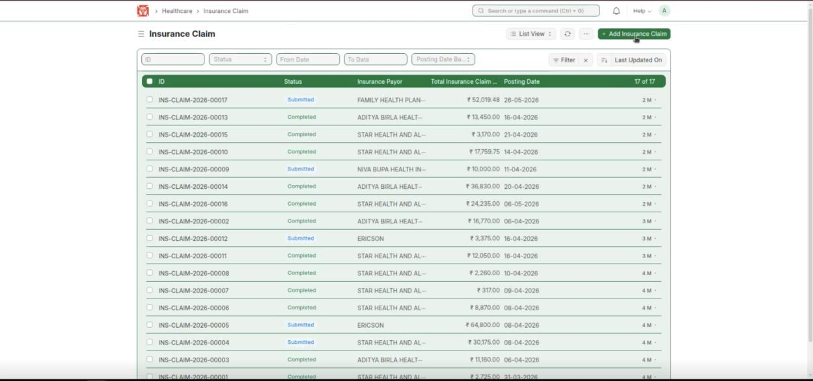

*Insurance Claim list — pick the patient or add a new claim*

2. Fill in the claim details — insurance payor, party (customer) and the patient.

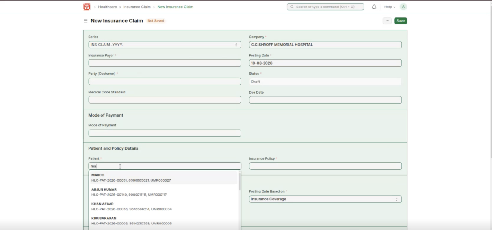

*New Insurance Claim — enter the payor, party and patient*

3. Once the patient, policy and payor are set, the claims are fetched automatically from the patient's insurance coverages.

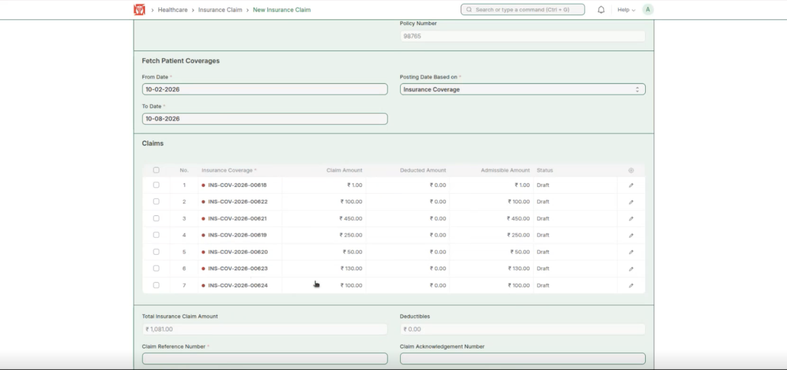

*Claims are fetched automatically from the patient's coverages*

4. Set the deducted amount for any item so each claim's admissible amount is correct.

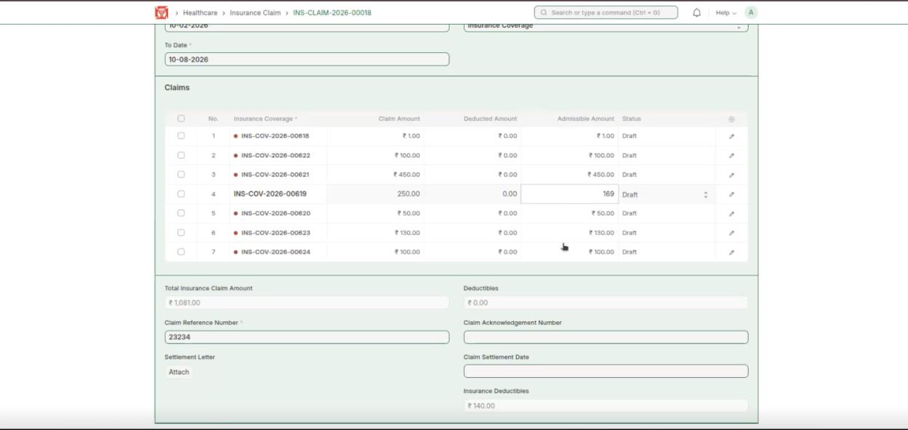

*Set the deducted amounts*

5. Attach the settlement letter from the insurer.

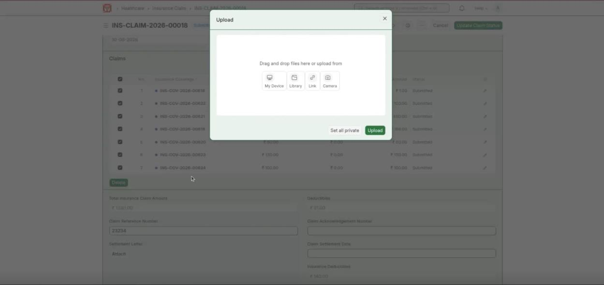

*Attach the settlement letter*

6. Select all the claims and click **Update Claim Status**.

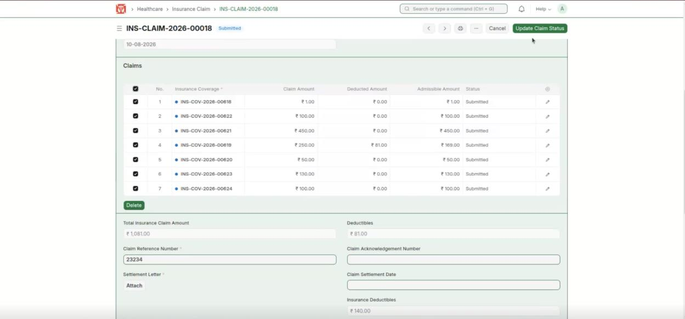

*Select all claims → Update Claim Status*

**Expected result:** The insurance claim is raised and its claims are updated.

## Receive the Payment

**Steps:**

1. Click **Create Payment Entry** to record the money received from the insurer.

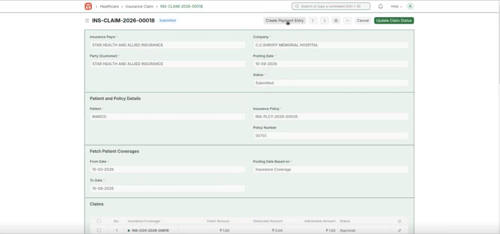

*Create Payment Entry*

2. Choose the Mode of Payment, fill the details, and **Submit**.

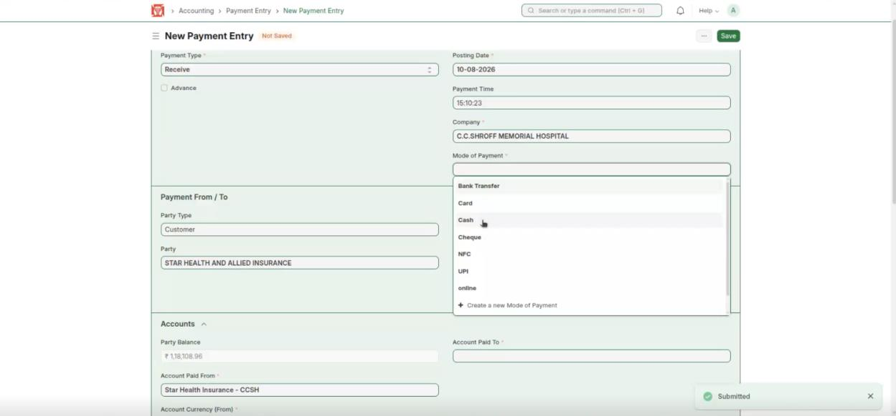

*Payment Entry — choose the mode of payment*

3. The sales invoice is now marked **Paid** — the hospital has received the amount from the insurance company.

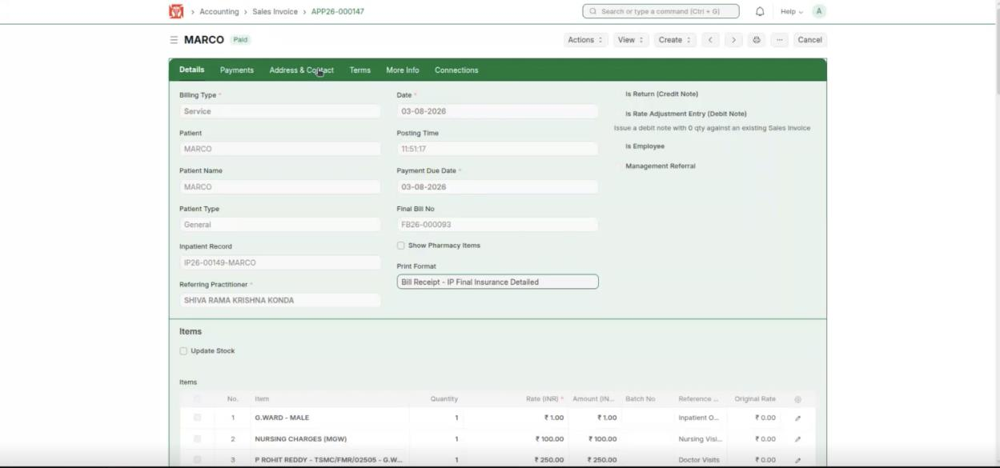

*Sales Invoice — marked Paid*

**Expected result:** The insurer's payment is recorded and the bill shows Paid.
