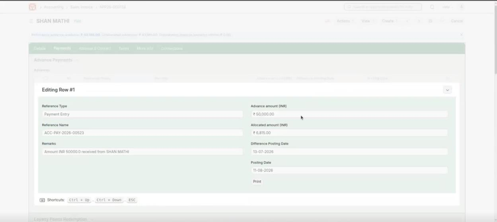
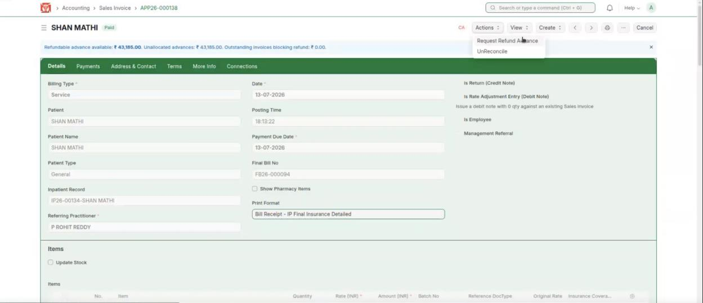
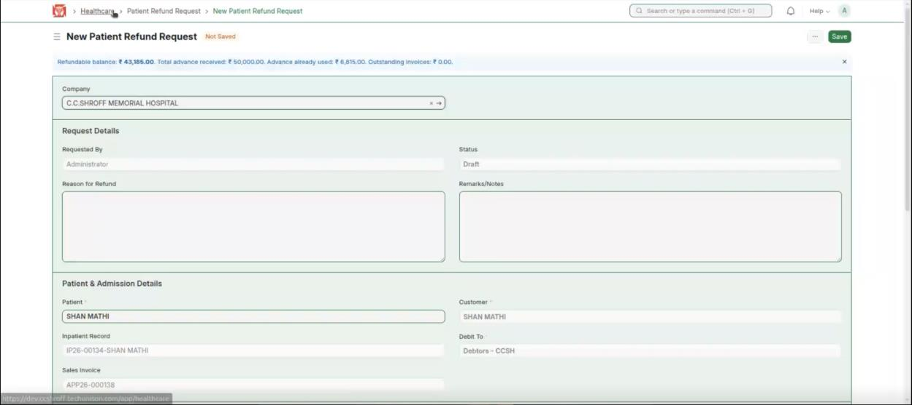
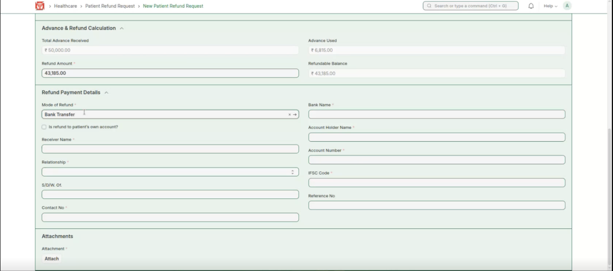
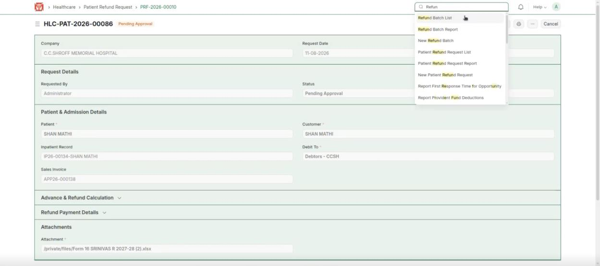
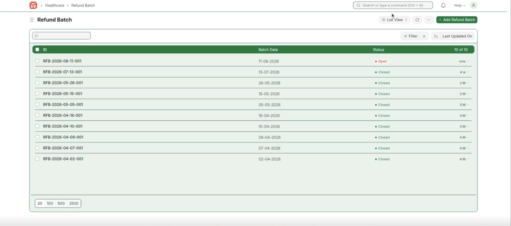
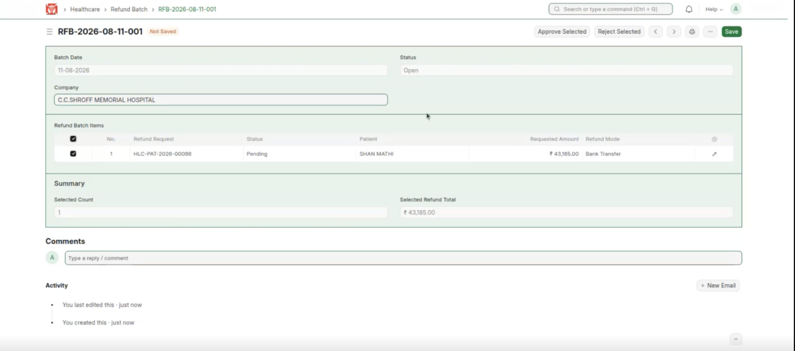
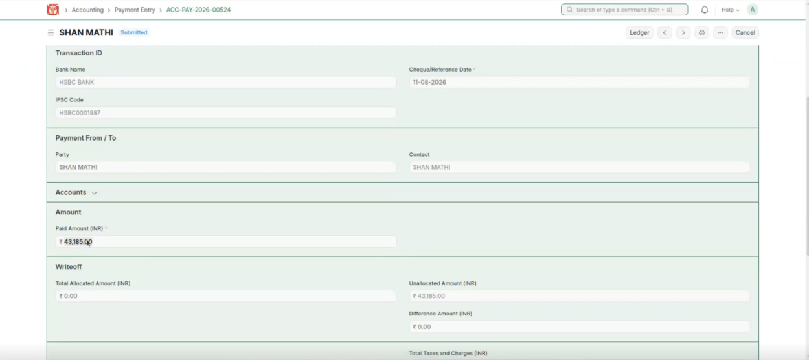
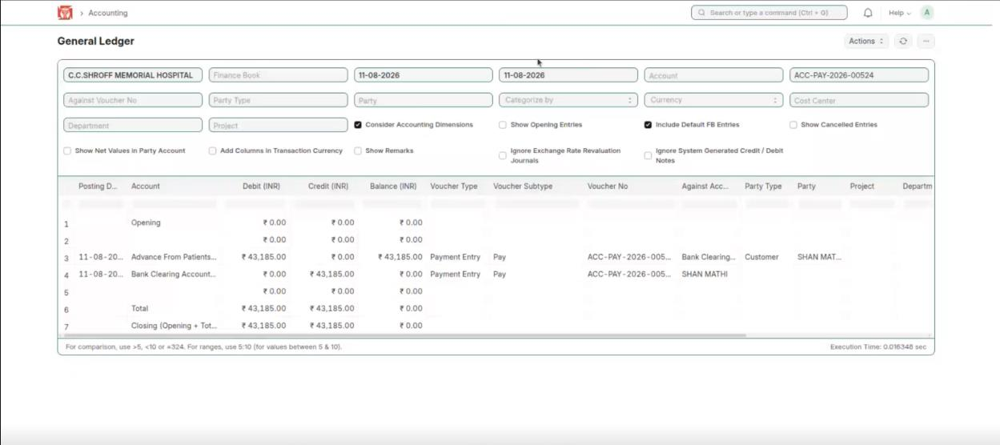

This covers refunding a patient's unused advance. For example, if a patient paid ₹50,000 in advance but the bill was only ₹6,815, the hospital refunds the remaining ₹43,185. (Demo patient SHAN MATHI.)

**Flow:** Advance paid > bill → Refundable balance shown → Request Refund Advance → Refund request (auto-filled) → Approve in Refund Batch → Payment Entry created → Refund shown in the ledger

## Request the Refund

**Steps:**

1. Open the patient's paid sales invoice. The advance paid (₹50,000) is more than the bill (₹6,815), so the balance must be refunded.

*Sales Invoice — advance ₹50,000, bill ₹6,815*

2. A blue banner shows the refundable amount (here ₹43,185). Click **Actions → Request Refund Advance**.

*Actions → Request Refund Advance*

3. The **Patient Refund Request** opens with the details filled in automatically.

*Patient Refund Request — details filled in automatically*

4. Check the Advance & Refund Calculation. If the refund is more than ₹5,000, the Mode of Refund is set to **Bank Transfer** automatically.

*Refund calculation — Mode of Refund set to Bank Transfer*

**Expected result:** A refund request is created for the unused advance.

## Approve the Refund

**Steps:**

1. To approve the refund, go to the **Refund Batch** list.

*Search → Refund Batch List*

2. The list shows one refund batch per day — all refund requests for a day fall under the same batch. Open the batch you need.

*Refund Batch list — one batch per day*

3. Select the refunds to process and click **Approve Selected** (or **Reject Selected**).

*Refund Batch — Approve or Reject the selected refunds*

**Expected result:** The selected refunds are approved (or rejected).

:::note
If a refund is rejected, you must give the reason for rejecting it.
:::

## Refund Payment and Ledger

**Steps:**

1. When the refund is approved, a Payment Entry is created for the refund.

*Payment Entry — refund of ₹43,185*

2. The refund is also posted to the ledger — you can see ₹43,185 refunded.

*General Ledger — ₹43,185 refunded*

**Expected result:** The refund is paid and recorded in the accounts.
