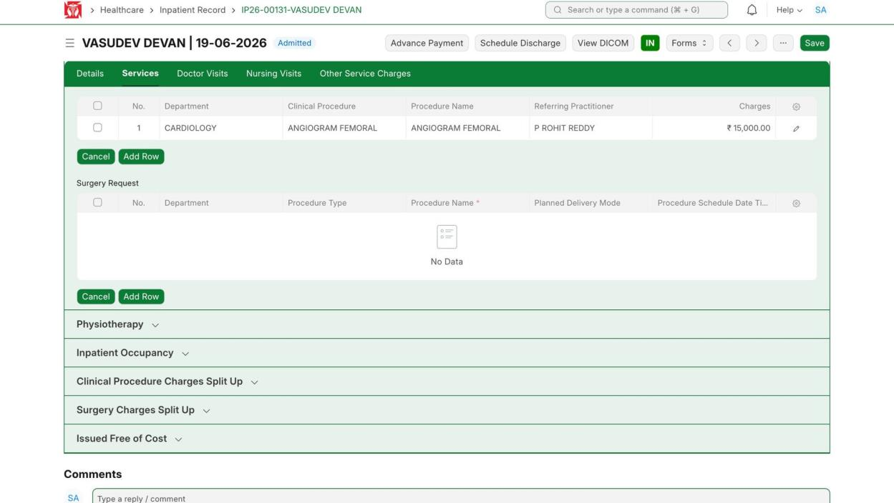
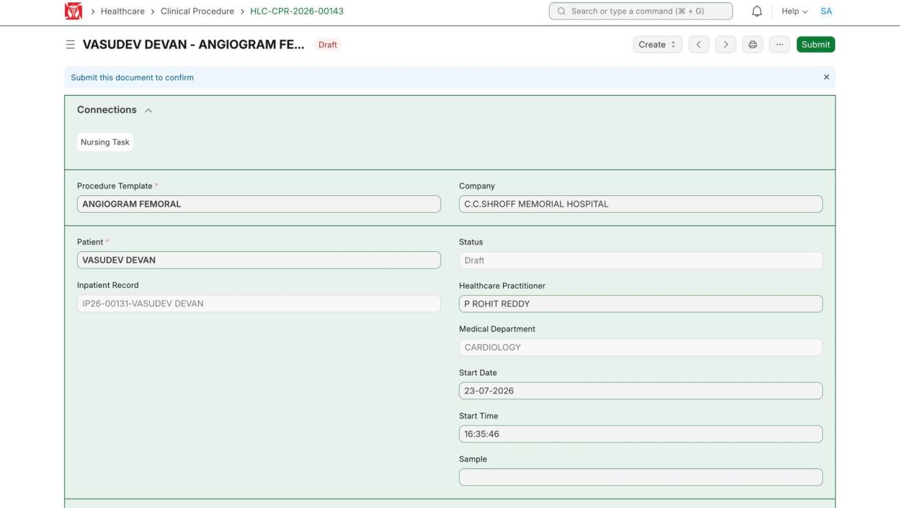
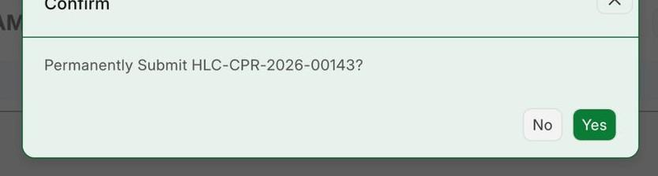
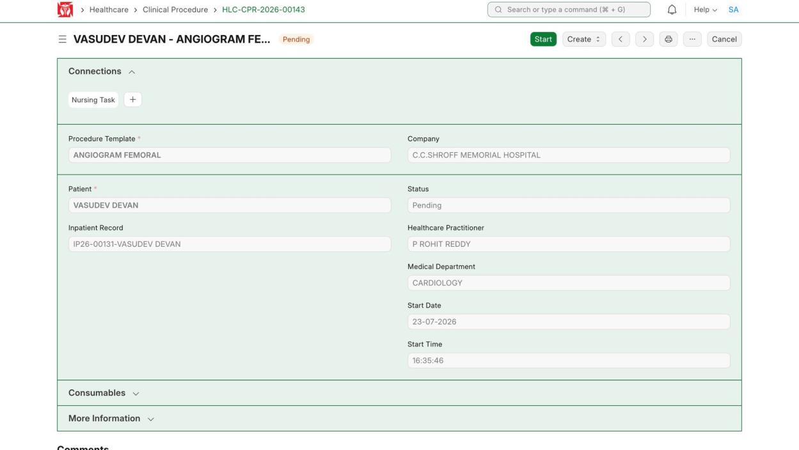
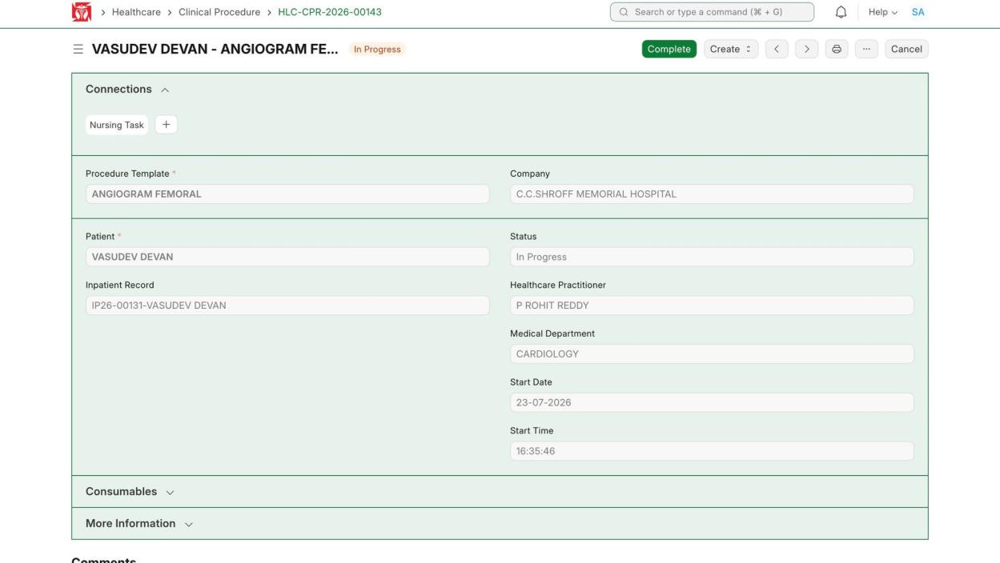

This covers a procedure: order it, submit the document, then move it through Start and Complete. (Demo patient VASUDEV DEVAN, IP26-00131; procedure ANGIOGRAM FEMORAL.)

**Flow:** Order procedure (Services) → Submit → Start → Complete

## 3.1 Order the Procedure

**Navigate to:** Inpatient Record → Services → Procedures

**Steps:**

1. Open the patient's record and go to the Services tab.
2. Under Procedures click **Add Row**, add the details (Department, Procedure, Doctor, Charges), then click **Save**.

*Procedures → Add Row → add the procedure*

*On Save, the Clinical Procedure is created*

**Expected result:** A Clinical Procedure is made and linked to the stay.

## 3.2 Open the Document and Submit

**Navigate to:** Healthcare → Clinical Procedure → HLC-CPR-2026-00143

**Steps:**

1. Open the procedure document and fill any missing details.
2. Click **Submit**, then confirm with **Yes**.

*Procedure document — check the details*

*Confirm — submit the procedure*

**Expected result:** The procedure is submitted and Status becomes **Pending**, with a **Start** button.

## 3.3 Start the Procedure

**Steps:**

1. When Pending, click **Start** to begin.

*Pending — click Start*

**Expected result:** Status changes to **In Progress** and a **Complete** button appears.

## 3.4 Complete the Procedure

**Steps:**

1. When done, click **Complete**, then confirm with **Yes**.

*In Progress — click Complete when done*

**Expected result:** Status becomes **Completed**. The procedure is finished.
