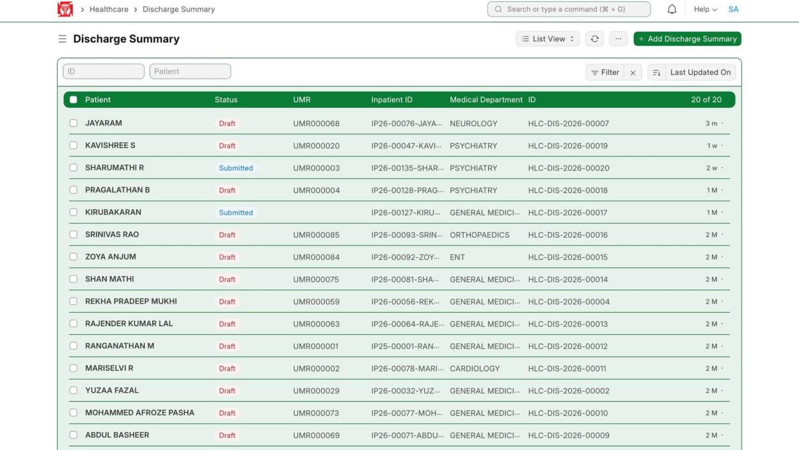
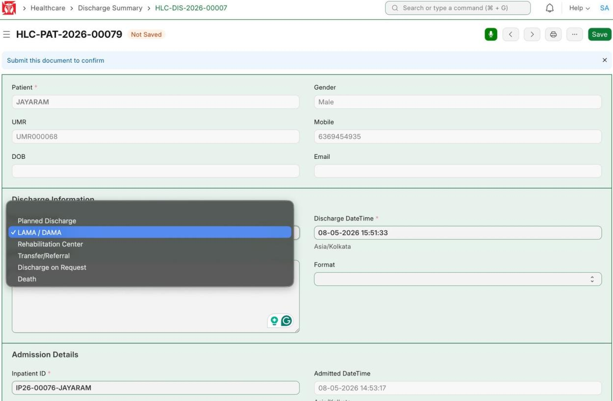
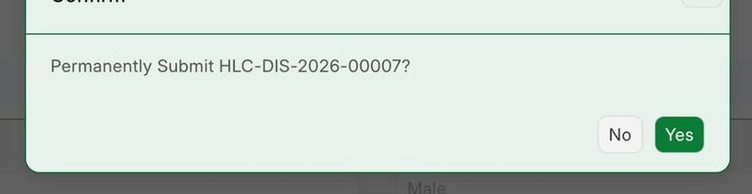
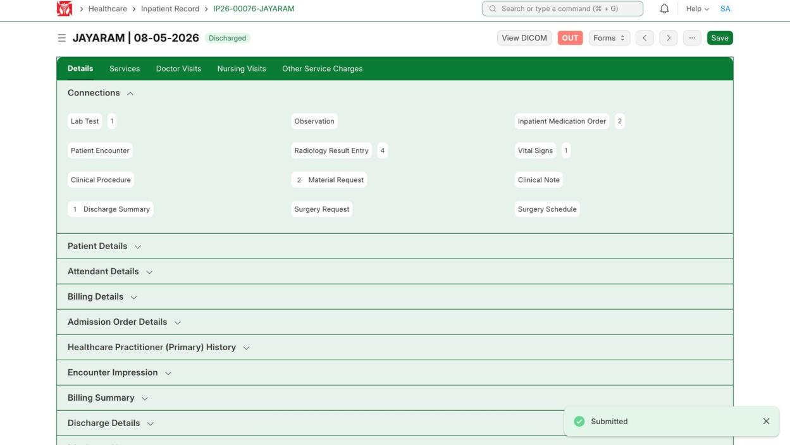
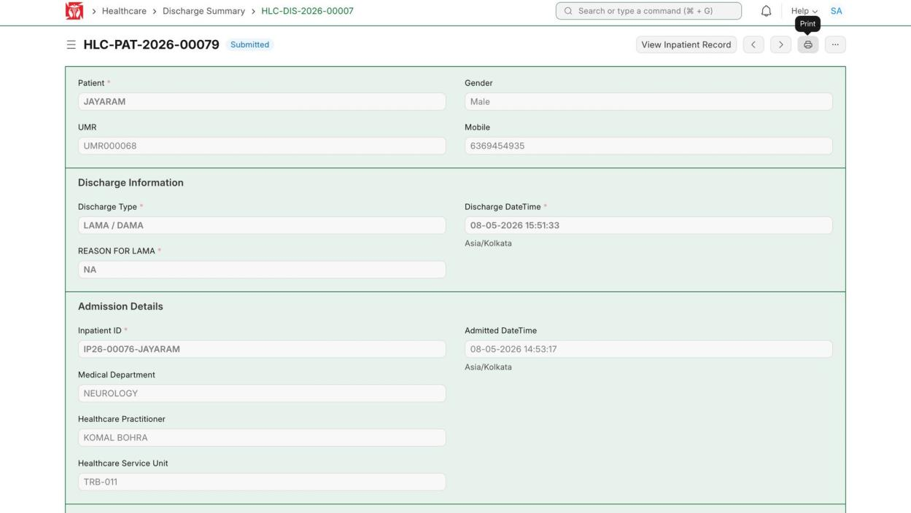
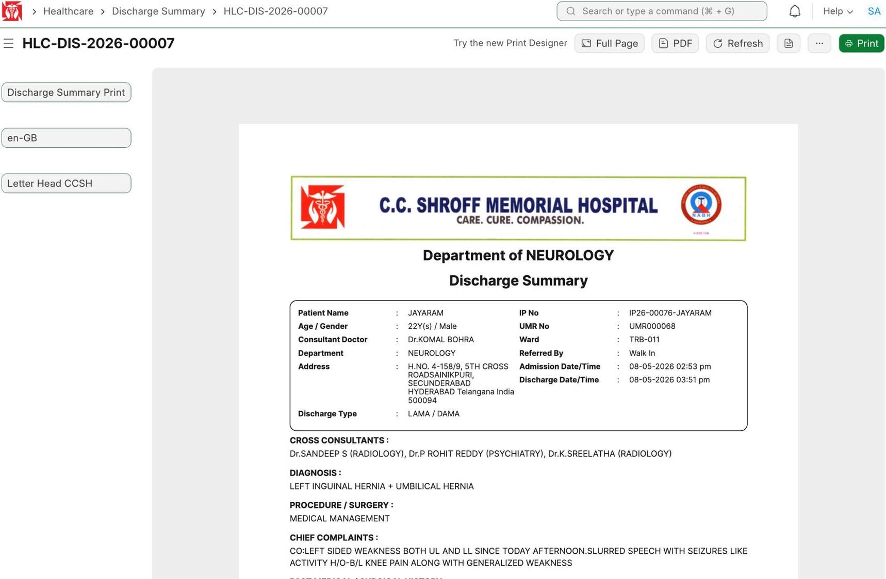

This covers writing and submitting the discharge summary, which marks the patient Discharged, and printing the report. (Demo patient JAYARAM, summary HLC-DIS-2026-00007.)

**Flow:** Open summary → Fill details → Save → Submit → Patient Discharged → Print report

## 4.1 Open the Discharge Summary

**Navigate to:** Healthcare → Discharge Summary → choose the patient

**Steps:**

1. From the Discharge Summary list, open the patient's summary.

*Discharge Summary list — choose the patient*

**Expected result:** The patient's summary opens.

## 4.2 Fill and Save the Summary

**Steps:**

1. Fill the Discharge Information (Discharge Type, date and time), the examination (vitals), and the notes (Follow Up, Patient Education, Urgent Care, Emergency Contact).
2. Click **Save**.

*Fill the discharge summary (e.g. Discharge Type)*

**Expected result:** The summary is saved as a draft.

## 4.3 Submit the Summary

**Steps:**

1. Click **Submit**, then confirm with **Yes**.

*Confirm — submit the discharge summary*

**Expected result:** The summary is submitted.

## 4.4 Patient Is Marked Discharged

**Steps:**

1. After you submit, the patient's Inpatient Record is marked Discharged on its own.

*Inpatient Record — Discharged (red OUT)*

**Expected result:** The patient shows **Discharged**. The workflow is done.

## 4.5 Print the Discharge Report

**Navigate to:** Healthcare → Discharge Summary → [submitted summary] → Print

**Steps:**

1. On the submitted summary, click the **Print** button (top right).
2. Print the discharge report.

*Submitted summary — click Print*

*The printed discharge report on the hospital letterhead*

**Expected result:** The discharge report prints on the hospital letterhead, ready to give to the patient.
