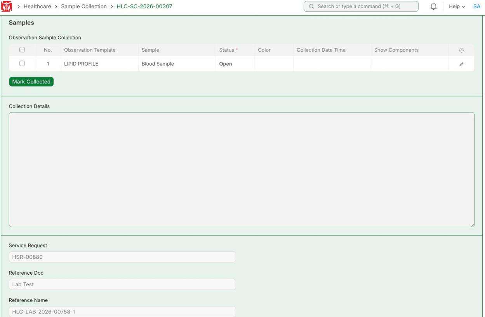
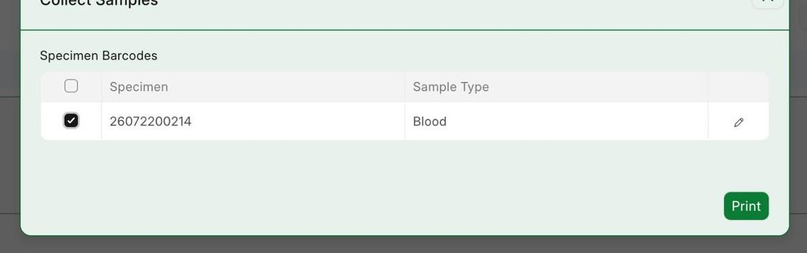
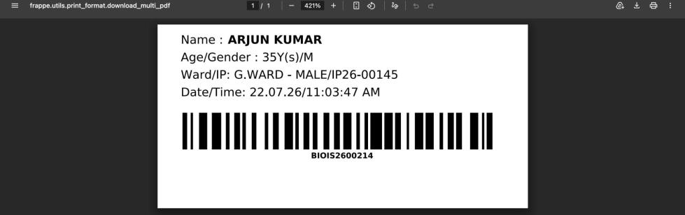
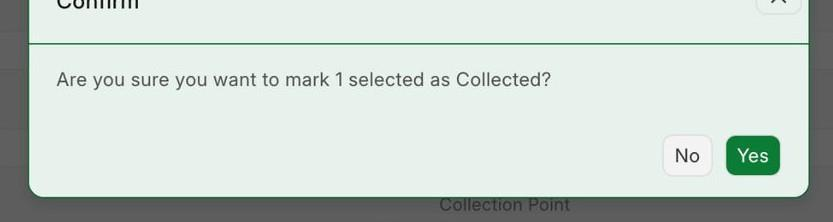
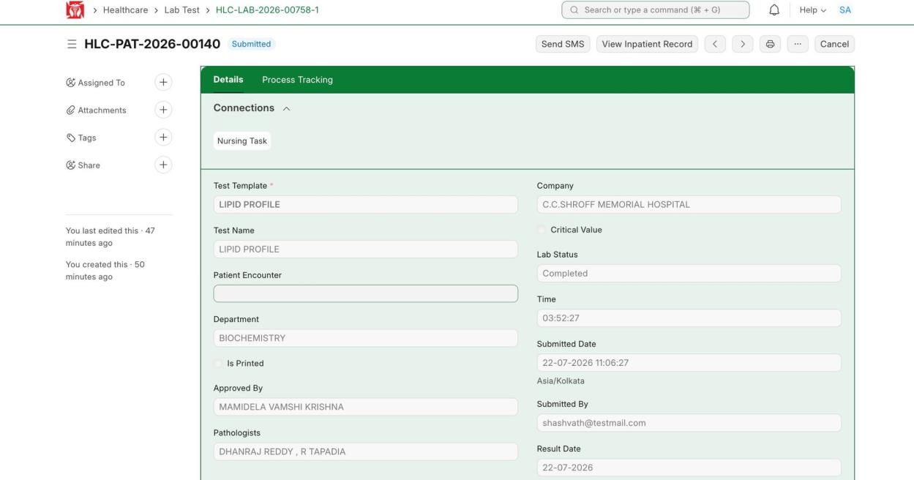

This covers a lab test after it is ordered: check the test, collect and label the sample, mark it collected, and submit it so it goes on the bill. Doing this clears the block at discharge.

**Flow:** Order test (Services tab) → Open Sample Collection → Print barcode → Mark Collected → Enter results → Complete the test

## 1.1 Open the Sample Collection

**Navigate to:** Healthcare → Sample Collection → HLC-SC-2026-00307

**Steps:**

1. Open the sample collection linked to the test (patient ARJUN KUMAR, IP26-00145).

*Samples — LIPID PROFILE, Blood Sample, with the Mark Collected button*

**Expected result:** The sample to collect is listed.

## 1.2 Print the Barcode

**Steps:**

1. Click **Print Barcode** (top right). A new tab opens with the barcode.
2. Print it and stick it on the sample, so scanning it later shows the patient's details.

*Collect Samples — print the specimen barcode*

*The printed barcode label*

**Expected result:** A barcode is printed for the sample.

## 1.3 Mark Collected and Submit

**Steps:**

1. In the Samples tab, tick the sample and click **Mark Collected**; confirm with **Yes**.
2. Click **Submit** to submit the sample collection.

*Confirm — mark the sample as Collected*

**Expected result:** The sample is marked collected and submitted. The test is now billed, which clears the discharge block.

## 1.4 Enter Results and Complete the Test

**Steps:**

1. Open the lab test for the collected sample and enter the result values.
2. Click **Save**, then **Complete** the test to finish it.

*Lab Test — Completed with the result approved*

**Expected result:** The results are recorded and the Lab Test shows Lab Status = Completed.
