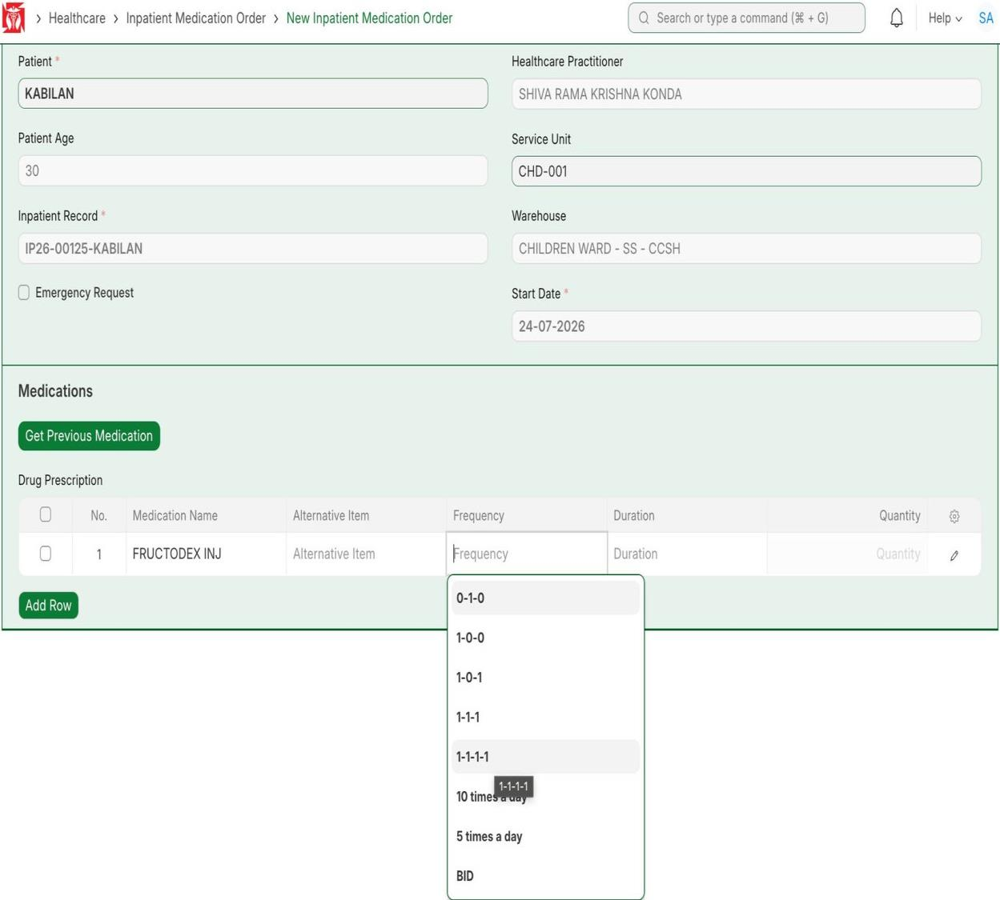
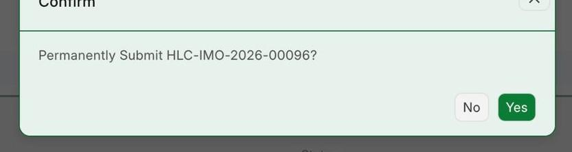
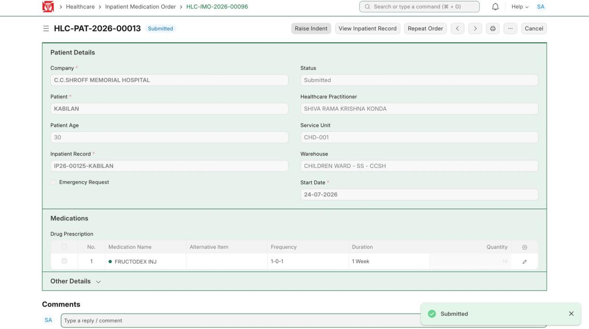
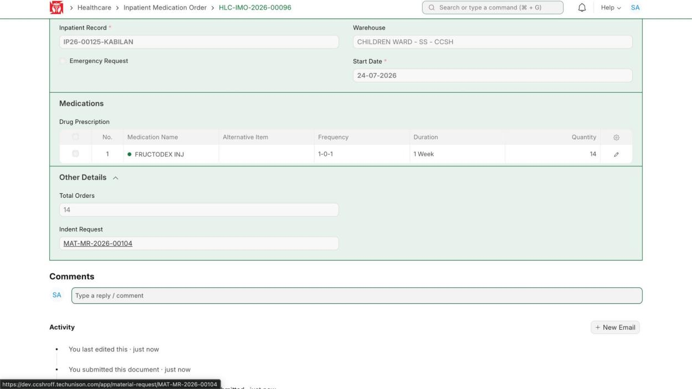
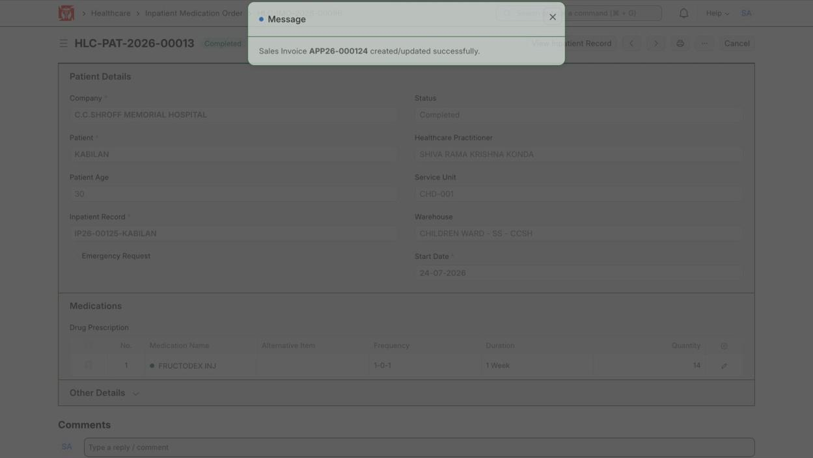
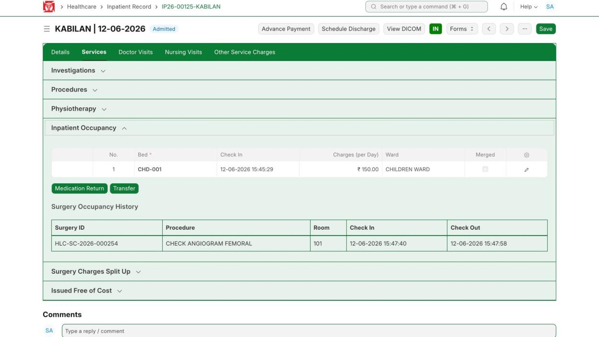
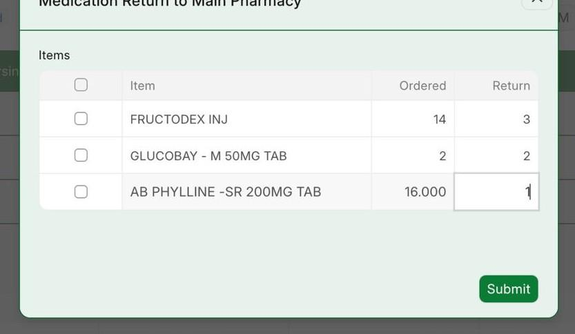
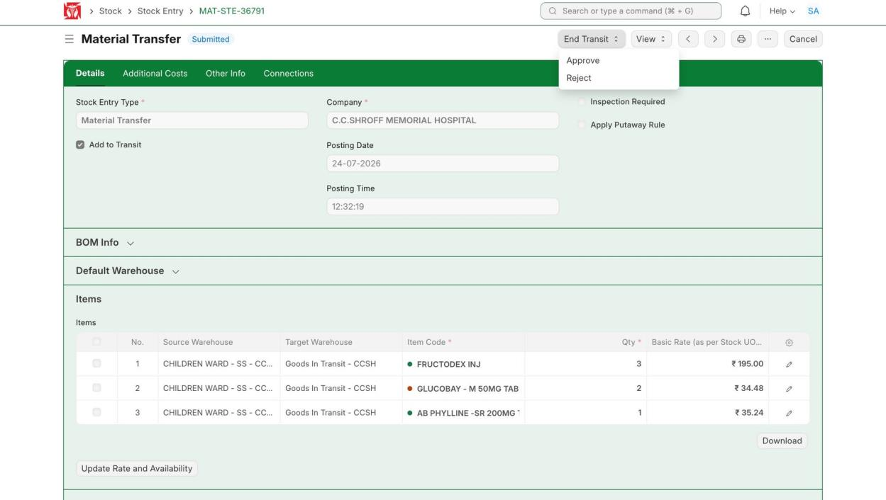

This covers giving medicine to an inpatient: make the order, raise an indent to the pharmacy, approve the transfer, add the medicine to the bill, and return any medicine not used. (Demo patient KABILAN, IP26-00125.)

**Flow:** Make medicine order → Submit → Raise Indent → Approve transfer → Acknowledge receipt (adds to bill) → Return if not used

## 5.1 Make the Medicine Order

**Navigate to:** Inpatient Record → Inpatient Medication Order (+) — or Healthcare → Inpatient Medication Order → New

**Steps:**

1. In the order form, add the medicine (e.g. FRUCTODEX INJ), the frequency (e.g. 1-0-1) and how long.
2. Click **Save**.

*Add the medicine and how often to give it*

**Expected result:** The medicine order is saved as a draft.

## 5.2 Submit the Order

**Steps:**

1. Click **Submit**, then confirm with **Yes**.

*Confirm — submit the medicine order*

**Expected result:** The order (HLC-IMO-2026-00096) is submitted.

## 5.3 Raise Indent to the Pharmacy

**Steps:**

1. On the submitted order, click **Raise Indent** to ask the pharmacy for the medicine.
2. Open **Other Details** to see the Indent Request number (e.g. MAT-MR-2026-00104).

*Submitted order — click Raise Indent*

*Other Details — the Indent Request number*

**Expected result:** A request goes to the pharmacy.

## 5.4 Approve the Transfer and Acknowledge Receipt

**Steps:**

1. Click the Indent Request number to open the Material Transfer, and **Approve** it.
2. Then click **Acknowledge Receipt** on the order — the medicine is added to the patient's bill.

*Acknowledge Receipt — medicine added to the bill (APP26-000124)*

**Expected result:** The medicine is given and its cost is on the bill.

## 5.5 Return Medicine (if the patient returns it)

**Steps:**

1. Click **View Inpatient Record**, open the Services tab, and open Inpatient Occupancy.
2. Click **Medication Return**, choose the medicines and how many to return, then **Submit**.

*Services → Inpatient Occupancy → Medication Return*

*Medication Return — pick the items and amounts*

3. Open the matching Stock Entry (Material Transfer) and use **End Transit → Approve** to return it, or **Reject** to keep it billed as used.

*Stock Entry — End Transit → Approve (returned) or Reject (used)*

**Expected result:** Approve removes the returned amount from the bill. Reject keeps it on the bill as used.
