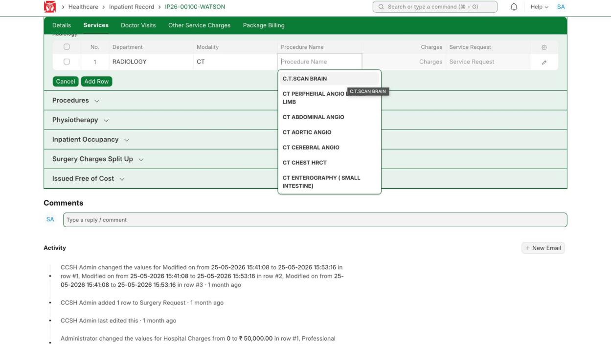
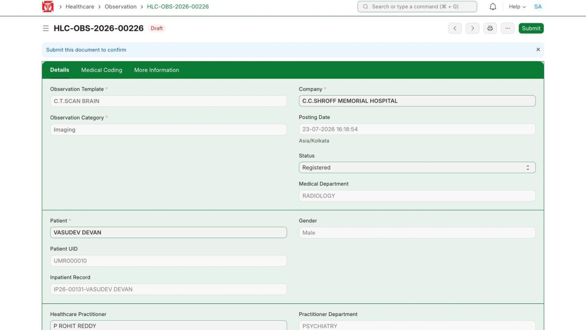
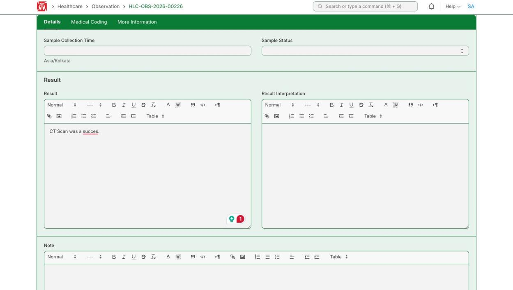
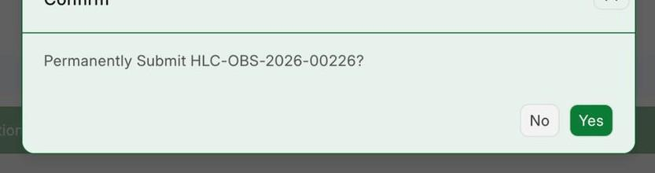
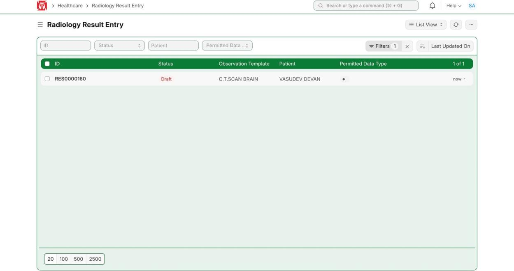
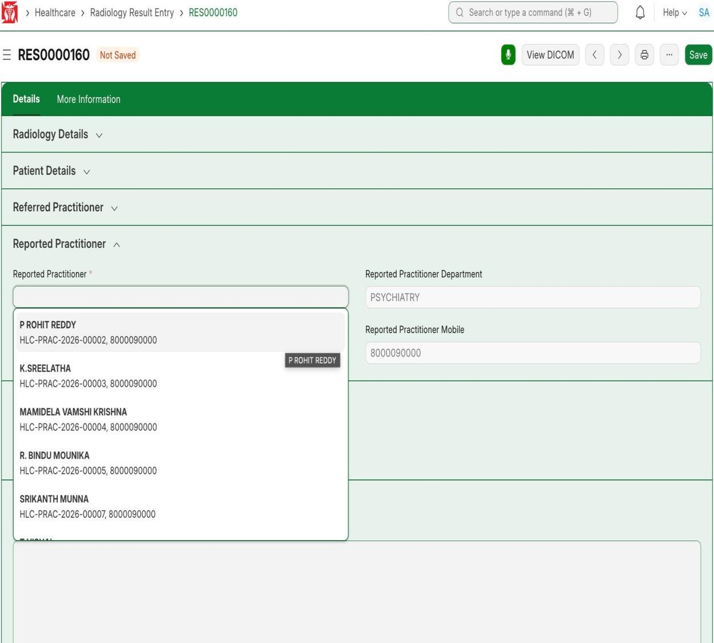
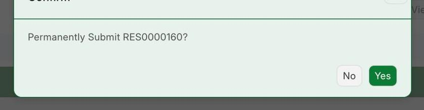

This covers a scan: order it, write the result, submit it, mark the test completed, and finish the Radiology Result Entry. (Demo patient VASUDEV DEVAN, IP26-00131; scan C.T.SCAN BRAIN.)

**Flow:** Order scan (Services) → Write result → Submit → Mark Test Completed → Open Result Entry → Add practitioner → Submit

## 2.1 Order the Scan

**Navigate to:** Inpatient Record → Services → Investigations → Radiology

**Steps:**

1. Under Radiology click **Add Row**, set the Modality (CT) and Procedure Name (C.T.SCAN BRAIN), then click **Save**.

*Radiology → Add Row → pick modality and scan, then Save*

**Expected result:** The scan is added to the stay.

## 2.2 Open the Scan Document and Write the Result

**Navigate to:** Healthcare → Observation → [the scan document, e.g. HLC-OBS-2026-00226]

**Steps:**

1. Open the scan document — it shows the patient, department and doctor.
2. Type the Result (and Notes if needed), then click **Save**.

*Scan document — patient, department and doctor*

*Type the result*

**Expected result:** The result is saved on the scan document.

## 2.3 Submit the Document

**Steps:**

1. Click **Submit**, then confirm with **Yes**.

*Confirm — submit the scan document*

**Expected result:** The scan document is submitted.

## 2.4 Mark Test Completed and Open the Result Entry

**Steps:**

1. When the test is done, click **Test Completed** to mark it complete.
2. Then click **View Radiology Result Entry** to open the list.

*Radiology Result Entry list — open your report*

**Expected result:** The Radiology Result Entry list opens.

## 2.5 Finish the Result Entry

**Steps:**

1. Open your report (e.g. RES0000160) and pick the **Reported Practitioner** who did it.
2. Fill the rest, then click **Save** and **Submit**.

*Pick the reporting doctor*

*Confirm — submit the result entry*

**Expected result:** The result entry is finished and submitted.
